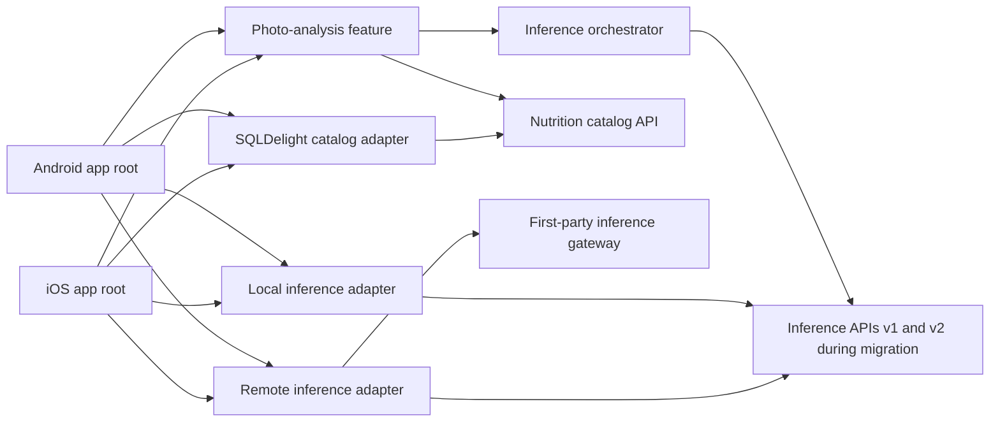
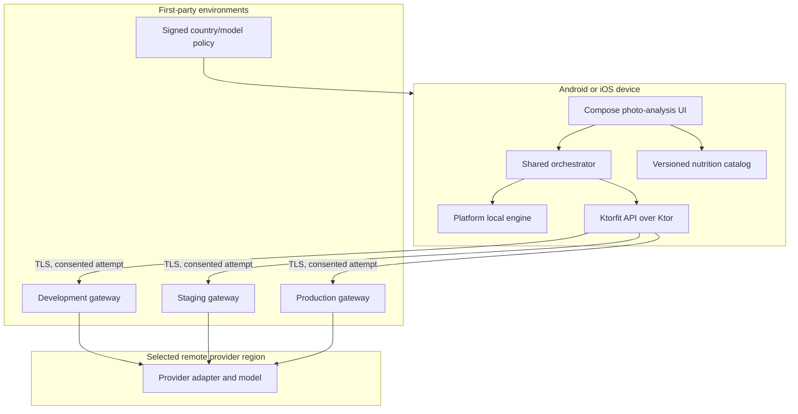

# Architecture Spine — SuperNutrition

> Current delivery-policy amendment (2026-07-29): Apple Silicon, exact
> Xcode, canonical iOS simulator, and physical-iOS evidence are good-to-have
> compatibility evidence, not local activation blockers. Required local and
> Android gates remain authoritative; pending Apple evidence is never success.

## Design Paradigm

Ports-and-adapters with a unidirectional state machine:

- `mobile/feature` owns Compose presentation; `mobile/domain/inference` owns only the Engine contract/evidence vocabulary; `mobile/domain/photo-analysis` owns pure routing, consent/fallback policy, workflow state, and attempt coordination.
- `core` owns cross-cutting UI, navigation, network, model, and platform ports without feature policy.
- `data`, `inference`, and `platform` own adapters.
- `mobile/apps` are thin hosts/composition roots; `mobile/testing` owns reusable test support; `backend/mobile-api` is the separately deployed first-party gateway/API.



## Invariants & Rules

### AD-1 — Inward dependency direction

- **Binds:** all modules and stories
- **Prevents:** circular dependencies and business rules embedded in platform or provider adapters
- **Rule:** Presentation may call application ports; application may call domain ports; adapters implement domain or platform ports; only app composition roots may select concrete adapters. No inward module may depend on an outward module.

### AD-2 — Versioned inference contract

- **Binds:** FR-5..FR-12, FR-24..FR-25, SM-7..SM-10, `mobile/domain/inference`, all inference engines
- **Prevents:** local and remote developers producing incompatible candidates, errors, or capability states
- **Rule:** Every engine implements `PhotoInferenceEngine` contract version `1`. Input is a `PhotoRef` plus immutable attempt context. Output is identification evidence—ranked candidates, per-engine calibrated confidence, assumptions, and provenance—and contains no calories, macros, or micronutrients.

### AD-3 — Local and remote ownership isolation

- **Binds:** `mobile/inference/local-android`, `mobile/inference/local-ios`, `mobile/inference/remote`, `mobile/domain/inference`
- **Prevents:** one inference team blocking or importing implementation details from the other
- **Rule:** Local and remote inference modules may depend on `domain/inference` and manifest-approved core ports but never on one another. Their builds, tests, engine-specific photos/outputs/provider responses/fault fixtures, and owners are separate. Canonical contract fixtures remain immutable artifacts owned by `domain/inference`; the orchestrator in `domain/photo-analysis` sees only the shared Engine contract.

### AD-4 — Platform-pure common code

- **Binds:** FR-1..FR-4, FR-24, `platform/photo-android`, `platform/photo-ios`
- **Prevents:** Android or Apple image objects leaking into shared state and making common tests platform-bound
- **Rule:** Compose owns product screens. Independently testable platform photo modules implement native camera/picker bridges and return an opaque `PhotoRef`; a `PhotoContentSource` port supplies normalized bytes and metadata. `Bitmap`, `Uri`, `UIImage`, `NSURL`, and framework controllers are confined to those platform adapters, never app hosts.

### AD-5 — One photo-analysis state machine

- **Binds:** FR-1..FR-21, all UX transitions
- **Prevents:** duplicate navigation callbacks, mutually impossible UI states, and platform-specific workflow forks
- **Rule:** `domain/photo-analysis` owns a sealed state/event/effect reducer and is the sole mutator of photo-analysis workflow state. It also owns `RoutePolicy`, consent/fallback decisions, and attempt coordination through a one-way dependency on `domain/inference`. Decompose owns lifecycle and screen route boundaries only. The transition contract covers capture, quality check, consent, analysis, review, serving, result, Back, replacement, background/restore, external-effect acknowledgement, cancellation, retry eligibility, manual alternatives, and recoverable error. Invalid actions are unrepresentable or ignored deterministically; a declined remote route is not offered again in the same attempt unless the user explicitly requests it.

### AD-6 — Deterministic routing and one terminal result

- **Binds:** FR-6..FR-12, FR-20..FR-21, NFR-1..NFR-3, NFR-9..NFR-11, SM-7..SM-10
- **Prevents:** silent uploads, fallback loops, late results overwriting cancellation, and two engines winning the same attempt
- **Rule:** Routing is a pure decision from capability snapshot, the closed
  route policy, explicit per-attempt remote consent, and attempt token. A ready
  Local Engine runs first unless the user explicitly selects another permitted
  route. Remote may be offered after a local attempt only for local
  unavailability, Local Engine abstention, or a Gate G-5 low-confidence result;
  G-5 may tune the threshold but cannot authorize escalation after a successful
  high-confidence local result. A typed `RemoteEligibilityReason` records the
  trigger, and configuration cannot invent another trigger. Remote transfer is
  modeled as `PreTransfer`, `Transferring`, then `Transferred`: cancellation
  before transfer sends no bytes; during transfer it aborts transport and
  downstream work; after transfer it suppresses results and requests
  downstream deletion without claiming to recall sent bytes. Each attempt has
  at most one active engine and exactly one terminal outcome; late emissions
  are discarded.

### AD-7 — Catalog-grounded nutrition authority

- **Binds:** FR-13..FR-18, NFR-12
- **Prevents:** model-generated or silently substituted numeric nutrition
- **Rule:** Inference returns food identity evidence only. User confirmation maps a candidate to a canonical catalog item. A versioned SQLDelight catalog and deterministic serving calculation are the only sources of displayed nutrient numbers; every result carries catalog source, dataset version, serving basis, and assumptions. Every activated country profile has an approved bundled or cached offline-searchable package; activation is atomic and retains the previous valid package.

### AD-8 — Ephemeral image lifecycle

- **Binds:** FR-4, FR-8, FR-10..FR-12, FR-19, FR-22, NFR-4..NFR-8
- **Prevents:** raw-photo retention, sensitive logs, and transfer without consent
- **Rule:** Image bytes are scoped to an opaque attempt, encrypted by platform
  storage when persistence is unavoidable, never logged or placed in
  analytics, and deleted on success, error, cancellation, and expiry. Photo
  preparation strips EXIF, GPS, and all non-essential image metadata before a
  remote payload or consent receipt is created; the receipt binds the digest of
  the scrubbed normalized payload, not an unsanitized source file. Remote
  transfer begins only after an explicit consent receipt bound to that digest,
  purpose, market jurisdiction, processing region/provider policy, retention
  version, configuration version, and transfer state. The deletion contract
  covers device, gateway, provider, temporary files, caches, queues, logs,
  backups, and failure paths, with auditable evidence and honest limits.

### AD-9 — Versioned model and provider configuration

- **Binds:** local model packages, gateway provider adapters, NFR-6..NFR-8, NFR-18
- **Prevents:** unreviewed model replacement and results that cannot be reproduced
- **Rule:** Every active model or provider configuration is identified by immutable version, checksum or deployment digest, compatibility predicates, activation time, and rollback target. Engines report these identifiers in provenance. Selection is configuration, not feature-code branching.

### AD-10 — Explicit dependency injection

- **Binds:** `mobile/apps/androidApp`, `mobile/apps/sharedKit`, `mobile/apps/iosApp`, all engines
- **Prevents:** ambiguous engine resolution and hidden service-locator dependencies
- **Rule:** `mobile/apps/androidApp` is the sole Android Koin bootstrap owner. `mobile/apps/sharedKit` exports exactly one idempotent iOS composition/bootstrap API and is the sole iOS Koin bootstrap owner; the thin `mobile/apps/iosApp` host invokes it once and never starts Koin itself. Local and remote bindings use explicit `localEngine` and `remoteEngine` qualifiers. Domain, feature, platform, and engine code receives dependencies through constructors and does not access global Koin state.

### AD-11 — Contract and evidence gates

- **Binds:** all implementation stories, NFR-1..NFR-24, SM-7..SM-10
- **Prevents:** untested adapters and simulator-only platform claims
- **Rule:** AD-33 supplies the measurable unit-coverage floors and changed-code rule. Every engine passes the same contract suite. AD-34 supplies positive-journey UI acceptance on both platforms. Route-by-platform acceptance evidence must cover Android and iOS on real devices; emulator or simulator evidence cannot establish camera, performance, memory, or local-inference support.

### AD-12 — Country is independent from language

- **Binds:** Tier-1 reference cohort, FR-14..FR-18, FR-21, FR-25, NFR-6, NFR-10, NFR-15..NFR-16
- **Prevents:** one English locale silently selecting the wrong catalog, units,
  consent, market jurisdiction, or processing region
- **Rule:** Food preference and legal data-flow policy are separate axes. A
  `CatalogCountry` selects the nutrition data package and serving/measurement
  defaults; a `MarketJurisdiction` selects applicable consent, privacy, and
  user-rights policy; a `ProcessingRegion` selects the permitted gateway/provider
  region. A catalog choice can differ from market jurisdiction and processing
  region and must never change either as a side effect. Locale remains a
  separate user-overridable axis. The launch-country allowlist is remotely
  distributable signed configuration with a bundled safe default; it is not
  compiled into feature logic.

### AD-13 — First-party remote boundary

- **Binds:** FR-8, FR-10, FR-22, FR-25, `mobile/inference/remote`, `backend/mobile-api`, `contracts/mobile-api`, NFR-5..NFR-8
- **Prevents:** provider credentials in mobile apps and provider-specific schemas becoming the mobile contract
- **Rule:** Mobile clients call only the first-party inference gateway in the selected environment. Provider credentials and adapters remain server-side. The gateway validates request size/type, applies authenticated rate limits, maps responses to contract v1, and does not durably store raw photos.

### AD-14 — Allowlisted observability

- **Binds:** FR-12, FR-17, FR-22..FR-23, analytics, logs, crash reporting, SM-1..SM-10
- **Prevents:** sensitive photo or food-entry data leaking through diagnostics
- **Rule:** Telemetry fields are versioned and allowlisted. They may include opaque attempt ID, route, capability tier, duration and resource buckets, terminal outcome, controlled candidate/correction action codes, source-coverage code, and model/catalog/config version IDs when the applicable beta consent permits. Server-side correction telemetry is disabled until G-6 closes. Filenames, paths, image bytes, free-form labels, headers, tokens, and HTTP request or response bodies are forbidden.

### AD-15 — Bounded agent execution

- **Binds:** all agent-authored implementation
- **Prevents:** vendored prompts overriding project architecture, broad refactors, version churn, or skipped adapter tests
- **Rule:** The current story and cited ADs are authoritative over vendored agent defaults. One invocation owns one story and exactly one named ownership slice from this closed set: one product module plus its colocated tests; one platform host/source-set plus its colocated tests; one AD-36 protected root-policy slice; or one explicitly enumerated infrastructure-policy slice below. The only mobile scaffold exceptions are `mobile-build-policy` (`mobile/settings.gradle.kts`, `mobile/build.gradle.kts`, `mobile/build-logic/**`, `mobile/gradle/**`), `mobile-quality-policy` (`mobile/config/**`), `mobile-ui-acceptance-policy` (`mobile/.maestro/**`), `interaction-policy-contract` (`contracts/interaction-policy/v1/**`), and `mobile-scaffold-activation` (`mobile/product-lifecycle.toml` only); each has one distinct owner, cannot own product source, and requires a separate invocation. No story-wide invocation is valid. Version-catalog changes require the owning story and `mobile-build-policy` slice. Coroutine cancellation is rethrown. Photo bodies are never logged. Generated adapter and data-source code requires tests.

### AD-16 — Atomic toolchain tuple

- **Binds:** scaffold, CI, version catalog, NFR-9..NFR-10, NFR-19
- **Prevents:** independently current versions forming an unbuildable Android/iOS toolchain
- **Rule:** Kotlin, Compose, Gradle, AGP, JDK, Xcode, macOS host, Android SDK, deployment floors, Detekt generation, and coverage tool are one reviewed mobile tuple. The mobile scaffold story proves the tuple and convention-plugin build by compiling and testing common, Android, and iOS targets with Koin, Decompose, Ktor, Ktorfit, and SQLDelight integrated; it also proves mobile repository enforcement, strict dependency verification/locks, Linux `qualityCheckJvmAndroid`, and macOS `qualityCheckApple`. Both task requests run twice with configuration cache enabled and `problems=fail`: the first stores and the second reuses the entry without opt-outs. Any tuple member upgrade is a dedicated compatibility change that updates the evidence report.

### AD-17 — Canonical schemas and compatibility fixtures

- **Binds:** FR-5..FR-8, FR-12, FR-24..FR-25, mobile engines, gateway
- **Prevents:** teams serializing different candidate fields, identifiers, enums, or compatibility behavior
- **Rule:** `mobile/domain/inference` owns Kotlin Engine types, serialized field names, namespace-qualified identifiers, unknown-value behavior, and the Engine compatibility matrix. Cross-product mobile-to-backend envelopes and canonical JSON fixtures are published separately under `contracts/mobile-api/`. Released fixture sets are immutable, versioned CI artifacts; compatibility changes test mobile and backend against every supported released set and require contract-owner approval.

### AD-18 — Leased photos and idempotent effects

- **Binds:** FR-4, FR-8..FR-11, FR-19, `PhotoRef`, photo-analysis effects
- **Prevents:** use-after-cleanup, duplicate remote upload after restoration, and the same effect executing twice
- **Rule:** A `PhotoRef` is valid only for the owning attempt lease. Every external effect carries stable `effectId` and `attemptId`; the app-root effect runner records at-most-once execution for transfer-start effects. Cleanup atomically revokes the lease and is idempotent.

### AD-19 — Canonical nutrition calculation

- **Binds:** FR-13..FR-18, SM-4, `domain/nutrition`, `data/nutrition`
- **Prevents:** catalog and feature teams disagreeing on food IDs, unit conversion, rounding, or aggregate totals
- **Rule:** The nutrition catalog owns namespace-qualified food and serving IDs, SI-normalized decimal conversion, source precision, calculation precision, display rounding, and per-item-to-meal aggregation. Packages are signed, checksummed, license-identified, schema-compatible, staged, atomically activated, rollback-capable, and fixture-tested. Golden fixtures cover every supported unit, range, rounding boundary, and partial item.

### AD-20 — Atomic configuration precedence

- **Binds:** FR-6, FR-9..FR-10, FR-24..FR-25, Tier-1 country profiles
- **Prevents:** one attempt combining incompatible country, route, model, provider, or consent policies
- **Rule:** One signed `ConfigurationSnapshot` resolves precedence in this order:
  bundled safe default, global release, environment, then independent
  `CatalogCountry` and approved `MarketJurisdiction` policy overrides applied by
  the single `MarketPolicyResolver`. It carries a distinct policy-resolved
  `ProcessingRegion`, locale, measurement system,
  device-capability tier/digest, one monotonic version, and a compatibility
  matrix. An inference attempt captures one validated snapshot.
  A catalog or approved market-policy profile change during correction
  terminates that attempt, clears remote consent and mapped results, preserves
  only user-visible candidate text, and starts manual grounding under a new
  snapshot; changing the catalog cannot silently change the processing region.

### AD-21 — Bound environment, authenticated gateway, and telemetry schema

- **Binds:** FR-8, FR-22..FR-23, NFR-5..NFR-8, dev/staging/production
- **Prevents:** production builds reaching test services, unauthenticated gateway abuse, and incomparable evaluation events
- **Rule:** A signed build flavor fixes gateway origin and trust-key set. An attested installation session exchanges for a short-lived token scoped to environment, installation, request digest, and nonce; request IDs are one-time. The gateway enforces key rotation, revocation, replay detection, abuse throttling, and a compromise runbook. Provider credentials remain server-side. `domain/inference` owns the versioned telemetry event schema and golden fixtures used by mobile, gateway, and evaluation ingestion.

### AD-22 — Preprocessing parity and honest rollback

- **Binds:** FR-4, FR-7, FR-24..FR-25, local engines, model manifests
- **Prevents:** Android and iOS classifying different normalized pixels or claiming rollback over platform-managed models
- **Rule:** Each model manifest fixes normalization, color space, dimensions, taxonomy, and golden pixel/output parity fixtures. Downloaded app-managed packages use checksum-verified inactive slots and atomic activation/rollback. Platform-managed models report capability and immutable version; if parity or policy fails, that route is disabled and the previous compatible bundled or app-managed engine remains usable.

### AD-23 — Accessible localized presentation and bridge

- **Binds:** FR-1..FR-3, FR-13..FR-21, NFR-13..NFR-16, Compose UI, Android and iOS camera/photo bridges
- **Prevents:** Compose and native surfaces exposing incompatible accessibility, localization, tone, or lifecycle behavior
- **Rule:** Presentation contracts cover semantic roles, contrast, non-color state cues, dynamic type/font scaling, text expansion, bidi, localized numbers/units, reduced motion, target sizes, neutral externalized copy, lifecycle/disposal, permission, focus/zoom, rotation, spoken framing and quality cues, captured-image description, focus restoration, and error semantics. Compose and bridge tests exercise platform accessibility services on real devices.

### AD-24 — Owned production operations

- **Binds:** FR-8, FR-22, FR-25, `backend/mobile-api`, production
- **Prevents:** a remote path shipping without accountable operation, deletion evidence, or emergency shutdown
- **Rule:** Production enablement requires a named service owner, SLOs, alerts, retention/deletion and user-rights evidence, cost and rate-limit dashboards, jurisdiction-specific data-flow inventory, incident and notification runbook, provider kill switch, configuration rollback, and a recorded rollback drill. Product privacy/legal approves provider-region and telemetry-purpose changes; the service owner enforces them.

### AD-25 — Layered multi-module topology

- **Binds:** all Gradle and Xcode modules, NFR-18
- **Prevents:** app or feature modules absorbing domain, adapter, and reusable test responsibilities
- **Rule:** Inside `mobile/`, module groups are `apps`, `core`, `domain`, `data`, `inference`, `platform`, `feature`, `testing`, and `evaluation`. `domain` is pure KMP with no Android, Apple framework, Compose, Koin, Ktor, Ktorfit, or SQLDelight dependency. `apps` are thin hosts/composition roots; `feature` depends inward on domain/core; platform, inference, and data adapters implement domain/core ports. The mobile backend is not a Gradle module group: it lives at `backend/mobile-api/` behind the versioned `contracts/mobile-api/` boundary. Distributable production source sets and configurations never depend on `testing`. The only app-to-testing edges are the two manifest-listed AD-28 non-distributable UI-acceptance configurations and their exact replacement-port allowlists; configuration-level negative graph fixtures prove those edges cannot resolve from any store, release, framework, gateway, or internal-beta configuration.

### AD-26 — Central build and dependency policy

- **Binds:** settings, version catalog, build logic, every module
- **Prevents:** per-module SDK, compiler, repository, lint, or dependency-version drift
- **Rule:** `mobile/gradle/libs.versions.toml` owns mobile versions and SDK/JVM floors. `mobile/build-logic` owns convention plugins for KMP library, Compose feature, Android app, iOS export, testing, and quality. `mobile/apps/androidApp` uses `com.android.application` with AGP built-in Kotlin and never `org.jetbrains.kotlin.android`; Android-bearing KMP libraries use `org.jetbrains.kotlin.multiplatform` plus `com.android.kotlin.multiplatform.library` and opt into required host/device test builders; pure KMP domain modules use only the multiplatform plugin and only targets they need. Compose modules apply `org.jetbrains.kotlin.plugin.compose`. Legacy Android/KMP plugin combinations are forbidden. Each product boundary has one central dependency/tool manifest and lock/verification state; root pins own shared CI/policy-tool versions only. No root package-manager workspace, lockfile, virtual environment, dependency installation, module-resolution path, or hoisted package tree may include more than one product. Each product performs a frozen install from its own manifest and lock into a product-local dependency/cache directory and proves that parent-directory or another-product resolution is impossible. Project-local repositories, dynamic/range/snapshot/direct-file/direct-URL dependencies, and cross-product workspace links are forbidden. CI never writes lock or verification state. Dependency or verification-metadata changes are isolated, provenance-recorded, and independently approved. Module scripts declare only identity, targets, and dependencies.

### AD-27 — Read-only aggregated quality gate

- **Binds:** every pull request, NFR-17..NFR-19
- **Prevents:** CI silently rewriting code, partial module checks, and coverage claims omitting branches
- **Rule:** In AD-37 `active` state, mobile `qualityCheckJvmAndroid` is read-only and aggregates the AD-29 Linux matrix: Detekt and its pinned formatting ruleset with autocorrect off, Android lint, required common/JVM/Android host tests, the AD-34 profile-selected common Compose contract suite, the pinned Kover JVM/Android-host line and branch variant, mobile consumption of every supported immutable `contracts/mobile-api` release, strict dependency/lock integrity, and forbidden-dependency/plugin checks. As an unconditional first step in every lifecycle state, CI job `quality-linux` also runs the protected AD-36 root boundary/policy suite and contract-catalog reconciliation and emits their exact same-SHA fingerprints; the job cannot pass if either result is absent, skipped, empty, stale, or wrong-SHA. Active-state mobile `qualityCheckApple` adds `iosSimulatorArm64Test` execution of that same profile-selected authored Compose suite, other KMP iOS tests, framework export/link, `xcodebuild build-for-testing`, Swift/native bridge tests, an iOS simulator smoke test, and Apple dependency resolution. The active Android UI lane also executes that suite through `connectedAndroidTest` before Maestro, and CI reconciles nonzero profile-selected robot IDs/counts across all three tasks. While mobile is `scaffold-pending`, all four mobile jobs run the narrower AD-37 no-production policy gate and emit explicit same-SHA lifecycle evidence without claiming build, test, coverage, app, device, or UI results.

  In `active` state, `web/landing/quality-check` and `backend/mobile-api/quality-check` are read-only, product-owned entrypoints that compile/build, lint, unit test, enforce NFR-17 coverage, verify dependency integrity, and emit schema-versioned evidence; backend quality also validates its side of every supported `contracts/mobile-api` release. In `preselection` state they execute the narrower fail-closed AD-37 gate and may not claim build, test, coverage, or artifact evidence. CI wraps every task in clean-tree guards; the workflow is an optional cross-product aggregate. Hosted required statuses are optional and never replace the local product quality gates. Local product quality aliases run only their boundary and never claim the other products passed. Formatting/autocorrect entrypoints are explicit and never run in CI.

### AD-28 — Shared test-support modules

- **Binds:** all module tests and route-by-platform evidence
- **Prevents:** copied fakes, divergent fixtures, and inconsistent Koin/Compose platform test setup
- **Rule:** `mobile/testing/inference` owns only the reusable contract-suite runner, fakes, and builders that consume immutable canonical fixtures published by `mobile/domain/inference`; adapter-specific fixtures remain in each adapter's test source sets. `mobile/testing/compose-support` owns the versioned base robot DSL, Compose test host, Koin test utilities, synchronization/reporting hooks, and privacy-safe artifact writer. The non-production `mobile/testing/scaffold-probe` may own one bootstrap-shell robot and contract used only while AD-34 selects the `bootstrap` profile. All product screen robots and contracts remain beside their UI; the first-release set lives in `mobile/feature/photo-analysis/src/commonTest` and becomes mandatory with the `photo-analysis` profile. The DSL binds `@OptIn(ExperimentalTestApi::class)` to `androidx.compose.ui.test.v2.runComposeUiTest` and requires typed screen scopes, named step IDs, no raw selector use in test bodies, Compose-clock/idling synchronization, bounded `waitUntil`/`awaitIdle` with no sleeps, fixture reset/cleanup hooks, and a redacted failure bundle containing step trace, semantics tree, platform/locale/configuration, and screenshot. Bounded polling is allowed only while waiting for a declared asynchronous state before its assertion deadline. Once a product assertion is evaluated and fails, it is final for that attempt and is never re-executed into success; lookup failures may repeat only inside the same bounded wait, never after an assertion result is emitted. Negative DSL tests cover timeout, assertion finality, redaction, and selector-scope escape.

  UI acceptance uses two manifest-listed, non-distributable executables: an Android `uiAcceptance` application variant with a unique application ID and an iOS `SuperNutritionUIAcceptance` scheme/configuration with a unique bundle ID. In AD-34 `bootstrap` they contain only the thin hosts plus the non-production scaffold probe. In `photo-analysis` they build the production feature, domain, data, navigation, and app composition graph; only named Engine, gateway, catalog, configuration, and photo-input ports may be replaced at the app composition root. They contain no production credentials, permit only allowlisted fixture endpoints, have no publish/archive/export task, and are scanned for secrets and forbidden destinations. Every store, release, internal-beta, framework, and gateway artifact is scanned transitively and must contain no `testing` coordinate, package, resource, fake, test manifest, or test-only DI binding. A separate profile-appropriate release-composition smoke boots the real currently inventoried graph with external services disabled so fixture wiring cannot mask broken composition.

### AD-29 — Fail-closed source-set quality matrix

- **Binds:** every production module and source set, coverage, Linux/macOS/device CI
- **Prevents:** “eligible” becoming an undefined exemption, disabled tasks, zero-test success, and native policy escaping evidence
- **Rule:** Root policy defines one protected product-inventory schema used by mobile, web, and backend. Each active inventory is reconciled with the product's compiled/bundled source graph and lists every deployable module, package, worker/function, migration executable, generated runtime source, tests, coverage report, artifact, owner, and quality task. A versioned `mobile/config/quality/module-matrix.toml` becomes the mobile instance during its atomic AD-37 activation and also lists the AD-34 UI evidence profile, every robot source and UI-acceptance executable required by that profile, plus mandatory platform/device evidence. Before activation, every product lifecycle record must instead prove that no production source, dependency installation/lock, runtime, deployable build, or undeclared executable exists. CI generates the required task graph from all active inventories and fails on undeclared or merged-away deployable units, source-to-artifact reclassification, missing, disabled, ignored, filtered-to-zero, skipped, `NO-SOURCE`, empty-module, zero-test, zero-denominator, unmapped, or artifact-less work unless an independently approved expiring waiver names the source and executable replacement evidence. Active mobile reconciles profile-selected test IDs/result counts across `jvmTest`, `connectedAndroidTest`, and `iosSimulatorArm64Test`; compilation or a JVM-only pass is insufficient. Deterministic policy stays in covered common code; unavoidable Kotlin/Native or Swift branches require native coverage or an executable branch-to-test evidence map.

### AD-30 — Machine-enforced module placement and ownership

- **Binds:** AD-3 and AD-25 topology, package namespaces, CODEOWNERS, cross-team pull requests
- **Prevents:** empty shell modules, logic placed in app roots, and one change silently crossing Engine ownership
- **Rule:** A versioned `mobile/config/architecture/module-boundaries.toml` lists exact Gradle/Xcode projects, UI-acceptance executables, owned package/non-module path prefixes, allowed source sets, allowed direct/test-only dependency edges and replacement ports, forbidden imports/types, and named owners. The mobile graph is `apps -> feature|platform|inference|data|core`, `feature -> domain|core`, `platform|inference|data -> domain|core`, and `domain -> domain|core`; `core` cannot point outward. `testing` reaches declared tested modules only through test graphs and the two AD-28 non-distributable executables; `evaluation` receives explicit read-only test/evidence exceptions. Undeclared modules and edges fail. Root product-boundary checks from AD-36 reject every forbidden source, package/workspace, generated-code, runtime/configuration, cache, build, artifact, and deployment edge between `mobile/`, `web/landing/`, and `backend/mobile-api/`. CODEOWNERS gives the cross-platform UI-acceptance owner authority over the mobile scenario/journey manifests, shared Maestro flows/subflows/page schema, and platform selector dictionaries; feature owners own concrete common robots. Protected root boundaries include `contracts/`, CI/tooling, web landing, and mobile backend under distinct principals. A pull request crossing ownership domains requires an explicit integration story, separate owner-scoped invocations, and every affected approval.

### AD-31 — Non-waivable safety behavior suite

- **Binds:** AD-5, AD-6, AD-8, AD-14, AD-18, AD-21, mobile engines, gateway
- **Prevents:** 100% execution coverage masking wrong cancellation, consent, logging, replay, cleanup, or deletion behavior
- **Rule:** A mandatory production-adapter conformance suite covers the UX transition table, delayed/late emissions, property/fault cases, all three transfer states, duplicate effects, restoration, bounded retry/idempotency, consent revocation, zero-byte local paths, forbidden-log capture, photo-lease cleanup, authentication replay, and downstream deletion requests. Aggregate coverage cannot replace these assertions, and no suppression, waiver, or fixture update may remove a mandatory scenario.

### AD-32 — Quality controls test themselves

- **Binds:** settings, `mobile/build-logic`, root boundary tooling, quality tasks, dependency metadata, module and quality manifests
- **Prevents:** convention regressions making a green gate meaningless
- **Rule:** Gradle TestKit negative fixtures prove `qualityCheck` fails for project repositories, dynamic or unverified dependencies, forbidden module edges, testing leakage, disabled/ignored/zero tests, absent coverage, broad exclusions, and hidden autocorrect. Coverage input is reconciled with the compiled production class/source inventory; exclusions are exact generated-output paths or independently approved expiring entries. Any build, manifest, workflow, quality, or dependency-policy change runs this conformance suite.

### AD-33 — Dual-threshold unit coverage

- **Binds:** NFR-17, every compiled production source and module, pull-request and push CI
- **Prevents:** aggregate coverage hiding an untested module and the 85% floor weakening new deterministic code
- **Rule:** Every compiled production source/class in all three product boundaries belongs to exactly one module coverage denominator. Tool-measurable code maintains at least 85% unit-test line and branch coverage per module and per product's deduplicated aggregate. Mobile JVM/Android-host evidence uses the pinned Kover variant; web and backend use their product-pinned coverage tools after their AD-37 transition to `active`. Every executable repository file outside a product root must instead appear in the protected AD-36 root policy/contract-tool inventory with its own executable tests and the same 100% changed-line and changed-branch requirement; contracts themselves remain non-executable data. All production code is deterministic by default. Equivalent-evidence mode is allowed only for an unavoidable Native, Swift, framework, or hardware boundary whose exact branches, executable tests, owner, independent approval, and expiring review date appear in the owning product's quality manifest; there is no optional `covered` flag. Missing reports, zero denominators, duplicate sources/classes, unmapped sources, and unapproved classifications fail.

  Changed-code coverage uses the PR merge base for pull requests and merge groups. For an ordinary branch update it uses the push event `before` SHA; a new branch uses the merge base with the protected default branch, except an independently approved root branch uses the empty tree; a force-push predecessor is fetched by object ID before checkout and falls back only to the reviewed default-branch merge base when the object is unavailable. Branch-deletion events run policy-only validation and no build/coverage claim. Full required history is fetched. Coverage evaluates cumulative executable production lines and branch outcomes added or modified by the diff, follows renames, and excludes only exact generated-output paths approved under AD-32. Both changed-line and changed-branch coverage must be 100%. A missing or ambiguous source map/base SHA, shallow comparison, unreported changed branch, line-only result, or unclassified push shape fails.

### AD-34 — Layered cross-platform UI acceptance

- **Binds:** UJ-1..UJ-4, SM-9, NFR-20, Android and iOS app hosts
- **Prevents:** two drifting platform journey DSLs, shared logic passing while a packaged app is broken, and slow end-to-end tests replacing fast shared UI contract tests
- **Rule:** `mobile/config/quality/ui-evidence-profile.toml` has a protected monotonic profile. Mobile activates in `bootstrap`: the only UI contract is the non-production bootstrap-shell robot owned by `mobile/testing/scaffold-probe`, and the only Maestro flow is the non-product launch/DI smoke owned by `mobile-ui-acceptance-policy` under `mobile/.maestro/bootstrap/`. Both execute on Android and iOS, prove the packaged acceptance hosts, and contain no UJ/product-behavior claim. A bootstrap-profile app has no store/archive/export path and is not release-ready.

  The first `mobile/feature/photo-analysis` production source, screen, route, or product scenario must atomically switch the profile to `photo-analysis`; downgrade is forbidden. Domain reducer/ports and every production dependency must already be committed through their own stories. The transition story then coordinates separate AD-15 invocations for the feature module; `mobile/core/ui` automation IDs; `mobile-build-policy` module registration; `mobile-quality-policy` inventories/profile/catalogs; `mobile-ui-acceptance-policy` flows; and each of `mobile/apps/sharedKit`, `mobile/apps/androidApp`, and `mobile/apps/iosApp` composition/host wiring. No invocation may absorb another, and the final combined candidate must compile and test the currently inventoried production graph on the required local/Android lane; Apple host execution is good-to-have and remains explicitly optional. In `photo-analysis`, shared Compose semantics, state transitions, visibility/enabled/selected state, and bounded layout relationships are authored in `mobile/feature/photo-analysis/src/commonTest` against the AD-28 v2 robot DSL and execute as `jvmTest` and `connectedAndroidTest`; the optional `iosSimulatorArm64Test` lane may execute the same contract when available. Common pixel-golden identity is not claimed.

  In `photo-analysis`, checked-in `mobile/config/quality/positive-scenarios.toml` derives from every UJ-1 through UJ-4 main, alternative, and edge/recovery path that reaches a valid result or privacy-preserving cancellation, plus every SM-9 matrix dimension. Each entry has a stable scenario ID, UJ/FR/SM references, entry state, fixture tuple, ordered logical action/assertion IDs, linked non-visual oracle IDs, applicable native-gap IDs, and terminal outcome. `mobile/config/quality/journeys.toml` maps every catalog entry exactly once to one Maestro CLI 2.7.0 flow in `mobile/.maestro/photo-analysis/` and both platform runs. CI fails on a profile/task mismatch, unmapped, orphaned, or duplicate entries, any product source while `bootstrap` remains selected, and any bound UJ/SM-9 change without a catalog update.

  Maestro page objects are JavaScript `output` selector dictionaries loaded by `runScript`; platform-conditional `runFlow` loads only application identity and locator dictionaries. Platform files cannot contain control flow, actions, input, assertions, waits, retries, fixtures, skips, or alternate outcomes. “Same flow” means identical ordered logical action/assertion IDs, fixture ID, oracle IDs, and terminal-state ID after expansion; CI compares normalized Android/iOS fingerprints and permits differences only in approved locator and app-identity fields. Shared Compose nodes use one stable, locale-neutral `UiAutomationId` registry owned by `core/ui`, separate from localized accessibility labels; the Android semantics root enables `testTagsAsResourceId = true`, iOS exposes the same tags as accessibility identifiers, and selector-contract tests fail on missing, duplicate, orphaned, or platform-only IDs. Coordinate selectors are forbidden.

  The AD-28 UI-acceptance executables use deterministic fixtures and never use live model/provider output as an oracle. Each applicable non-visual oracle produces separate Android and iOS evidence bound to commit SHA, installed application/framework digest, process/network namespace, fixture/config digest, scenario ID, and platform. It records attempted connections, completed request count, byte count, photo digest, consent/effect ID, and terminal transfer state: local, offline, and declined-consent scenarios require zero attempts as well as zero transmitted image bytes; remote consent permits exactly the declared post-consent transfer; cancellation proves the specified transfer-state behavior.

  `mobile/config/quality/platform-contracts.toml` is the closed platform-sensitive denominator derived from NFR-9, NFR-13, AD-23, and every bound UX requirement. Each contract ID maps for each applicable platform to common, Maestro, or `native-gaps.toml` evidence, and CI rejects an unmapped contract or a source-requirement change without a catalog update. Every required native-gap result attests commit SHA, application/framework and fixture/config digests, device/OS identity, task version, and execution time. Optional Apple records use the same schema when present but may remain pending. The entry names source/module invalidation paths and maximum age; same-commit execution is mandatory when any required bound input changes, and cached evidence is valid only while every digest and invalidation input is unchanged. CI rejects missing, stale, detached, or non-successful required evidence.

### AD-35 — Every-push monorepo CI policy

- **Binds:** NFR-21, NFR-22, all workflows and required checks
- **Prevents:** unverified branch pushes, path-filter omissions, one monorepo product escaping checks, and partial platform matrices appearing green
- **Rule:** The checked-in GitHub Actions workflow is an optional adapter for every-push repository validation. When hosted, it may trigger on every `push` to every branch and every `pull_request`, with no branch/path filters or commit-message skip escape; branch-deletion pushes run the policy-only classification path defined by AD-33. Its declared matrix contains mobile `quality-linux`, `ui-journeys-android`, `quality-apple`, and `ui-journeys-ios`; `quality-web-landing`; and `quality-backend`. Every job executes the AD-27/AD-37 entrypoint for its exact product lifecycle even when another product appears unchanged; affected-only omission is forbidden. While mobile is `scaffold-pending`, its four jobs emit only the AD-37 no-production lifecycle evidence and do not provision devices or claim app/UI execution. In `active` state, mobile UI jobs provision the device, build and install the exact AD-28 executable, set the platform `APP_ID`, install Maestro CLI 2.7.0 from a checksum-verified asset, assert `maestro --version`, target the explicit device identifier, run exactly the AD-34 profile-selected `mobile/.maestro/<profile>/` inventory, and emit JUnit plus privacy-reviewed debug output. The active Android job first executes the profile-selected `connectedAndroidTest` IDs; the active Apple quality job executes the matching `iosSimulatorArm64Test` IDs. Bootstrap IDs prove only scaffold packaging/launch/DI; photo-analysis IDs and full UJ/SM-9 journeys become mandatory with the irreversible profile transition.

  Current local policy amendment: the hosted Apple and iOS UI jobs are optional adapters. If Apple tooling is unavailable, local `qualityCheckApple` remains the authoritative policy check and no Apple success is inferred; the required Android lane remains the device-side gate.

  The current checked-in GitHub adapter is intentionally reduced to
  `mobile-unit-coverage`. The six-job matrix and `ci-required` fingerprint
  aggregate remain optional reference policy only; they are not required for
  lifecycle activation or local completion claims.

  The optional `ci-required` job in the same canonical workflow declares direct `needs: [quality-linux, ui-journeys-android, quality-apple, ui-journeys-ios, quality-web-landing, quality-backend]`, uses only `if: ${{ always() }}`, and succeeds only when the expected job set is exactly those six and every `needs.<job>.result` is `success`. When run, it validates the root-boundary result, root-tool inventory digest, contract-catalog digest, supported-release-matrix digest, every product lifecycle/inventory digest, and every evidence manifest's schema, product ID, event, repository, full SHA, run/job IDs, expected test and coverage counts for its lifecycle state, and artifact digest. `quality-linux` supplies the root-boundary/catalog result and mobile compatibility result; `quality-backend` supplies the backend compatibility result; `ci-required` rejects unequal catalog/matrix fingerprints. Missing, skipped, empty, stale, unparsable, duplicate, user-supplied, or wrong-SHA evidence fails the optional hosted aggregate; local product quality gates remain authoritative.

  A workflow-policy test rejects job/step conditions outside the aggregate expression, `continue-on-error`, empty/excluding matrices, optional required inputs, ignored/quarantined required tests, result-neutralizing shell constructs, success fallbacks, floating action/CLI references, `pull_request_target`, untrusted secrets, or excess permissions. Full-SHA actions and least privilege are mandatory. Product assertion failures are never retried into success; only a classified device/runner startup failure before testing may receive one bounded infrastructure retry, and all attempts remain evidence. Maestro 2.7.0 can capture per-step and crash/device screenshots, so UI-acceptance fixtures contain no real user data, artifact paths/types are allowlisted and redacted, and retention is short and explicit.

  If a future hosting plan supports it, an optional repository or organization ruleset may enforce distinct-owner approval for canonical workflows, build logic, policy validators, evidence schemas, and hosted-check configuration. An optional `trusted-policy-audit` may validate candidate workflow policy from protected code; it never executes candidate code or exposes secrets. These hosted controls are not lifecycle, coverage, production-implementation, or release gates, and checked-in workflows never claim that external enforcement exists.

### AD-36 — Monorepo product boundaries and contract-only integration

- **Binds:** NFR-17, NFR-18, NFR-19, NFR-21, NFR-22, mobile app, public landing site, and mobile backend
- **Prevents:** a nominal monorepo becoming one coupled build, backend implementation leaking into clients, web changes bypassing quality, and cross-team work colliding at the repository root
- **Rule:** The only product implementation roots are `mobile/`, `web/landing/`, and `backend/mobile-api/`. Each root independently owns its runtime source, tests, frozen dependency installation and lock state, generated output, product-local cache, quality entrypoint, signed artifact and provenance, deployment workflow and environment, credentials, promotion decision, rollback, documentation, and distinct CODEOWNERS principal. Product compile, test, package, or deploy graphs may consume only product-local code plus pinned immutable contract releases; source imports, root or cross-product workspaces, project/package dependencies, generated-source writes, runtime calls/configuration, build-task dependencies, shared output directories, and deployment/artifact dependencies across product roots are forbidden.

  Root `contracts/` contains immutable, versioned, language-neutral schemas, compatibility metadata, canonical fixtures, and artifact manifests only; it contains no executable or product implementation. `contracts/mobile-api/` is authored, versioned, approved, and published only by a contract principal independent of mobile, backend, web, and repository-policy owners. Mobile and backend are equal consumers of the same content-addressed release and may generate product-local bindings without writing back or publishing a replacement. Every contract change tests new backend behavior against every supported released mobile contract, new mobile behavior against current and staged backend contracts, and both products against the previous immutable fixtures. Updating both products at HEAD is never sufficient. Additive changes prove backward and forward behavior; an incompatible change creates a new major release, coexistence window, server-before-client activation, minimum-supported-version policy, rollback plan, and removal story.

  `web/landing/` has no runtime dependency on `backend/mobile-api/`, provider services, mobile configuration, or `contracts/mobile-api/`, receives none of their credentials, and its rendered production experience remains functional when the backend is absent. Any future interactive web client is a separately named product root with its own contract, threat model, CI lane, owner, and deployment rather than a hidden expansion of the landing product.

  Root `tooling/` is allowlisted by a protected inventory to read-only repository-policy validation, evidence-schema validation, contract-data compatibility validation, and CI orchestration. It exposes no runtime library, product build plugin, source generator, shared test fixture, domain mapping, deploy helper, or product-specific configuration; product build graphs cannot depend on it. Executable files outside the three product roots are rejected unless their exact path, policy-only purpose, tests, coverage evidence, and independent owner appear in that inventory. Root boundary tests reconcile executable files, product inventories, outbound endpoints/events/configuration, build/workspace/import/generated-source paths, container/package graphs, cache keys/restores, dependency installation, release workflows, credentials, and CODEOWNERS to reject undeclared roots or coupling.

  Cache keys include product ID, runner/OS/architecture, toolchain digest, lockfile digest, product-source digest, and cache-schema version. Restore prefixes never cross product IDs; product jobs can write only their namespace; contract releases use a separate immutable read-only cache; restored keys and content digests are recorded and foreign, mutable, partial, or unverified content fails. Each product deploys only its separately versioned artifact plus a pinned compatible contract release, with separate credentials and rollback. Root workflows may dispatch but cannot build, publish, promote, or roll back multiple products atomically, use shared mutable release tags, or require another product artifact.

  The ownership manifest names distinct mobile, web, backend, contract, and repository-policy principals; one approval cannot satisfy multiple roles, relevant changes dismiss prior approval, and contract-owner approval is required for generated bindings and compatibility fixtures. A cross-product story coordinates separate owner-scoped invocations and all affected approvals. Each product can install, compile, and test from its directory in an environment without either other product's dependencies. Technology selection for `web/landing/` and `backend/mobile-api/` remains the separately reviewed AD-37 transition and does not silently choose a framework.

### AD-37 — Fail-closed product bootstrap lifecycle

- **Binds:** all three product roots, AD-27, AD-29, AD-35, initial monorepo bootstrap
- **Prevents:** empty placeholder jobs claiming production quality and production source appearing before a reviewed toolchain exists
- **Rule:** Each product has one protected, versioned lifecycle record conforming to the root inventory schema. Mobile begins `scaffold-pending` because its toolchain tuple is selected but no app/build substrate exists; web and backend begin `preselection` because their tuples remain unselected. In either non-active state, every named product job proves that no production source, product dependency installation/lock, runtime, deployable build, deployment config, or undeclared executable has appeared; validates applicable ownership, boundary, contract, and workflow policy; and emits same-SHA evidence with its exact state. Build, test, coverage, artifact, app, and UI claims are forbidden, and any production material fails.

  Mobile changes atomically to `active` only in the reviewed scaffold story that adds the pinned build substrate, frozen dependencies and locks, schema-conforming nonempty inventory, real read-only host/device quality entrypoints, nonzero tests and coverage denominators, fake-only app artifacts, owners, and non-distributable UI-acceptance executables. Web or backend changes atomically to `active` only in its separately reviewed toolchain story with the corresponding pinned runtime/build/lint/test/coverage tuple, product-local frozen dependencies and locks, schema-conforming nonempty inventory, real read-only quality entrypoint, nonzero tests and coverage denominators, artifact, owners, and deploy/rollback skeleton. The local equivalents of the declared AD-35 quality entrypoints must pass when run; hosted GitHub execution is optional. An `active` product can never return to a non-active state.

### AD-38 — Optional GitHub hosting enforcement

- **Binds:** AD-35 and optional repository governance
- **Prevents:** documentation claiming external GitHub enforcement when the current private-hosting plan cannot provide it
- **Rule:** The repository may remain private on a GitHub plan without private rulesets, organization-enforced required workflows, or a private merge queue. Checked-in CODEOWNERS, workflow, and policy files are local declarations and are validated locally; they do not claim external enforcement. A future hosting upgrade may add optional rulesets, required checks, merge queues, or a trusted policy auditor, but none is required for lifecycle activation, coverage authorization, production implementation, or release readiness.

### AD-39 — Canonical product and store identity

- **Binds:** NFR-23, Android and iOS app hosts, mobile acceptance executables,
  web landing, release metadata, store-delivery stories
- **Prevents:** different product names in launcher, in-app UI, acceptance
  fixtures, landing content, and store metadata
- **Rule:** `mobile/config/product-identity.toml` is the protected,
  machine-readable identity source. Its canonical product, installed display,
  launcher, in-app, and accessibility product name is exactly
  `SuperNutrition`. Its Apple App Store and Google Play listing title is exactly
  `SuperNutrition AI nutritionist`; `AI nutritionist` is store metadata only
  and cannot become the installed display name or in-app brand. Android labels,
  iOS display-name metadata, the `SuperNutritionUIAcceptance` scheme identity,
  web product metadata, and store-delivery metadata are generated from or
  validated against this manifest. CI tests every build profile and supported
  locale for exact values and rejects independent hard-coded variants. Bundle
  and package identifiers are selected by the scaffold story and recorded
  separately; they do not alter the visible naming contract.

### AD-40 — Low-friction interaction and safe defaults

- **Binds:** NFR-24, UX-DR37, all product screens and user-interaction-affecting
  stories, agent guidance, journey/action-budget evidence
- **Prevents:** choice-heavy happy paths, hidden assumptions, irreversible
  auto-actions, and defaults that silently change privacy, jurisdiction, or
  nutrition safety
- **Rule:** Interaction budget is a first-class acceptance property. All product
  policies conform to the immutable language-neutral
  `contracts/interaction-policy/v1` schema, which is created and versioned by
  the separately owned `interaction-policy-contract` slice. The mobile instance
  is the protected `mobile/config/quality/interaction-policy.toml`.

  The closed default allowlist contains only `defaultLocale`,
  `measurementSystem`, `catalogProposal`, and one atomic
  `standardServing` value (`unit` plus `amount`) after canonical-item
  confirmation. Food identity, preparation, oil, sauce, recipe, remote consent,
  provider-routing choice, and medical/allergen fields are never defaultable.
  The immutable `ConfigurationSnapshot` is the automatic source for context
  values and is materialized once per attempt. After canonical confirmation,
  the `CatalogServingDefaultSource` port in `mobile/domain/nutrition` may return
  an immutable catalog fact as an atomic serving proposal keyed to the current
  snapshot; it never mutates the snapshot and Candidate, locale, device, or a
  prior correction cannot create the proposal.

  `InteractionDefaultPolicy`, `ConfigurationSnapshot`,
  `DefaultResolutionInput`, `DefaultResolution`, `MarketPolicyResolver`, and
  `DefaultResolver` are contract-neutral types owned by `mobile/core/config`.
  `DefaultResolver` only returns `DefaultResolution`; it never imports or emits
  domain types. `DefaultProposal`, `DefaultDecision`, and their lifecycle are
  owned and mutated only by the `mobile/domain/photo-analysis` reducer. Compose
  presenters render these results and never resolve policy or mutate decision
  state.

  Every proposal and decision carries a proposal/decision ID, monotonic revision,
  expected snapshot and policy digests, canonical food/serving ID when present,
  source identity, and monotonic event sequence. The reducer accepts an event
  only when its ID, expected revision, and digests match the current attempt;
  events are serialized and idempotent, and an invalidation wins any same-revision
  race. The complete lifecycle is `Proposed -> Accepted | Overridden |
  Invalidated`, `Accepted -> Overridden | Undone | Invalidated`,
  `Overridden -> Overridden (new revision) | Accepted (Undo) | Invalidated`,
  and `Undone -> Proposed` only for a new proposal ID. Undo never re-runs the
  resolver. The atomic `standardServing` pair shares one proposal/decision ID
  and one lifecycle outcome.

  A first-use catalog proposal remains unaccepted until explicit confirmation and
  cannot auto-advance into grounding or remote transfer. A confirmed
  `CatalogCountry` may be persisted only as the next-attempt catalog context;
  the next attempt creates a new snapshot, while changing it during an active
  attempt invalidates that attempt and clears consent/mapped results. MVP food,
  preparation, serving, and meal corrections remain session-scoped and are not
  persisted as future defaults. Any future non-sensitive preference requires a
  separate story with scope, expiry, revocation, deletion, and reset behavior.

  Each happy path minimizes taps, scrolls, typing, and choice surfaces. Every
  default is rendered inline with source and provenance, remains editable and
  reversible, and is separate from measured/inferred facts. Auto-advance is
  reversible only when it does not trigger grounding, remote transfer, a saved
  result, or another irreversible data effect; serving confirmation remains the
  explicit boundary before nutrition calculation. `MarketPolicyResolver` alone
  resolves approved `MarketJurisdiction` and `ProcessingRegion` into the
  snapshot; `DefaultResolver` does not resolve them. The app shows those values
  in remote-consent detail and never derives or silently changes them from locale
  or catalog; the user consents to the resulting transfer, not to a provider-
  region picker. Medical/allergen conclusions are prohibited and cannot be
  enabled by confirmation; materially uncertain food identity requires a
  targeted question or Abstention.

  `InteractionBudgetEvidence` records schema/policy/config versions and digests,
  proposal/decision IDs, resolved value digest (never sensitive text), field ID,
  source identity, scenario, platform, locale, accessibility mode, default
  provenance, lifecycle outcome, event sequence, the required dimensions `tap`,
  `scroll`, `field`, and `choice`, and bounded auxiliary counts for
  `textEntryChars`, `choiceSurface`, `back`, `undo`, `cancel`, and
  `permissionPrompt`. Each journey manifest supplies non-negative approved
  maxima for every required and auxiliary dimension; CI fails on missing
  dimensions, digest/value mismatch, stale proposal, forbidden default, or an
  observed count above its approved maximum.

  Counting semantics are stable across Compose, Maestro, Android, and iOS:
  `tap` is one user activation of a semantic control; `scroll` is one user
  scroll gesture crossing the declared 24dp threshold; `field` is one distinct
  user-edited text/number field (default rendering is zero); `textEntryChars`
  counts entered characters without recording content; `choice` is one selected
  alternative or explicit consent decision; and `choiceSurface` counts distinct
  decision surfaces presented. A choice activation contributes to both `tap`
  and `choice` (the dimensions are cumulative, not mutually exclusive).
  Programmatic auto-advance, reducer events, and accessibility focus traversal
  are not taps; Back, Undo, cancellation, and system permission prompts are
  separate bounded typed events.

### AD-41 — Fail-closed market processing policy

- **Binds:** NFR-27, AD-8, AD-12, AD-13, AD-21, AD-40, every remote transfer of
  user content, `MarketPolicyResolver`
- **Prevents:** a market being served by a provider region its law does not
  permit, permission for one payload type implying another, and language support
  being mistaken for a market position
- **Rule:** `MarketPolicyResolver` resolves against signed policy data conforming
  to the immutable language-neutral `contracts/market-policy/v1` schema, created
  and versioned by a separately owned `market-policy-contract` slice. The mobile
  instance is the protected `mobile/config/quality/market-policy.toml`. Each
  market entry declares jurisdiction, `residencyPosture`, permitted processing
  regions, per-modality remote permission and consent-copy version, accepted
  input languages, and a named legal review with an approver and expiry.

  Every market defaults to `unresolved` and permits no remote inference of any
  modality; absence, `unresolved`, and expiry are equivalent at resolution time,
  and no posture is inferred from a neighbouring market, shared language,
  currency, or region grouping. A posture is set only by the named review and
  never widened as a side effect of a story, configuration change, or provider
  migration. Photo and text permissions are decided independently, each carrying
  its own reviewed consent copy, and a transfer presenting another modality's
  copy fails closed. Accepted input languages are independent of posture,
  jurisdiction, and permitted regions in both directions. Catalog choice cannot
  derive, widen, or silently change any of these values, and the resolved
  jurisdiction and processing region are displayed before every consent
  decision. Policy changes are isolated, provenance-recorded, and independently
  approved; CI never writes policy state. The deterministic catalog search floor
  and on-device identification do not depend on a posture, so fail-closed leaves
  every market usable. Full schema, market states, and evidence requirements are
  in `market-processing-policy.md`.

### AD-42 — Visible-component evidence and bounded mass estimates

- **Binds:** FR-32..FR-36, NFR-28, `contracts/inference/v2`, local Android/iOS
  inference, `domain/photo-analysis`, `feature/photo-analysis`, and evaluation
  harness
- **Prevents:** dish labels being presented as ingredients, pixels being treated
  as a scale, stale v1/v2 schemas, and model mass becoming nutrition authority
- **Rule:** `contracts/inference/v1` remains immutable. The sole future major
  release is modality-neutral `contracts/inference/v2`, which may return
  `VisibleComponent` evidence for visibly separable regions and an optional
  `MassEstimate` range. Every mass field carries a status
  (`estimated`, `not_evaluable`, or `abstained`), model/taxonomy/calibration
  provenance, assumptions, and a unit; it is never a measured fact, catalog
  binding, or nutrition result. Text identification returns mass
  `not_evaluable` absent a separately approved measurement modality.

  Component/mass models have an immutable manifest containing artifact and
  taxonomy digests, preprocessing/postprocessing, mask/instance contract,
  calibration version, runtime/EP, compatibility, activation, and rollback
  target. Android/iOS emit the same v2 fixtures and benchmark only on
  consented, tared, leakage-resistant ground truth. Nutrition5k can be
  license-reviewed attributed pretraining/benchmark-design data in a training
  environment, optionally accessed through a compact metadata index and
  selected-shard mirror; it is not app data and never replaces the consented
  phone-photo acceptance corpus. The UI displays a range only as editable
  evidence and otherwise provides an honest manual path. Model output never
  bypasses user confirmation or AD-7 catalog grounding.

## Consistency Conventions

| Concern | Convention |
| --- | --- |
| Contract naming | Ports are nouns ending in `Engine`, `Source`, `Catalog`, or `Policy`; immutable result types end in `Result`, failures in `Failure`, UI inputs in `Event`, one-time outputs in `Effect`. |
| Product identity | `mobile/config/product-identity.toml` declares `SuperNutrition` as the installed and in-app name and `SuperNutrition AI nutritionist` as the exact Apple App Store and Google Play listing title. Store descriptors never become launcher or in-app identity. |
| IDs and time | Attempt IDs are random opaque strings; persistent entity IDs are stable strings; timestamps are UTC instants; `CatalogCountry` and `MarketJurisdiction` use ISO 3166-1 alpha-2; `ProcessingRegion` uses the approved provider-region identifier; locale uses BCP 47. |
| Serialization | Public mobile–gateway envelopes carry `contractVersion`, `requestId`, and a sealed success/failure payload; unknown fields are ignored, unknown enum values map to `Unknown`. |
| Confidence | Confidence is calibrated within one engine/model version and is never compared across engines unless Gate G-5 supplies a validated calibration transform. |
| Errors | Expected failures are typed. `CancellationException` is always rethrown. UI receives recoverability and next-action semantics, not platform exceptions. |
| State | Shared workflow state is immutable; only the reducer mutates it. Adapter callbacks enter through events tagged with the current attempt token. |
| Logging | Structured and allowlisted; AD-14 applies before any logging interceptor is enabled. |
| Configuration | AD-20 snapshot precedence; invalid, expired, incompatible, or unverifiable configuration fails closed for remote upload. |
| Interaction budget | AD-40 governs shortest safe paths, visible/editable/reversible defaults, explicit sensitive decisions, atomic serving proposals, and per-journey required plus bounded auxiliary interaction evidence. |
| DI | Constructor injection; app-root Koin modules; explicit engine qualifiers; no global lookups. |
| Monorepo ownership | Product implementation lives only in `mobile/`, `web/landing/`, or `backend/mobile-api/`; `contracts/` contains independently owned immutable non-executable releases only. Every product has a distinct owner and independent dependency install, cache, artifact, runtime, quality, deployment, credentials, and rollback. Landing has no backend runtime edge. |
| Gradle ownership | Mobile module scripts declare identity, targets, and dependencies only. `mobile/build-logic` convention plugins own source-set, compiler, SDK, Compose, lint, test, and packaging defaults. |
| Dependency policy | Each product owns one central dependency/tool manifest, frozen installation, and lock/verification state; no root or hoisted multi-product workspace/install exists, and product graphs cannot consume root tooling or another product. |
| Quality commands | Mobile uses `qualityCheckJvmAndroid` and `qualityCheckApple`; web and backend use lifecycle-aware `quality-check` entrypoints that reject production material in preselection and become full read-only gates on activation. Formatting/autocorrect entrypoints are explicit and never run in CI. |
| Quality inventory | One protected root schema governs mobile, web, and backend inventories. Active products enumerate every deployable/runtime unit and its tests, coverage, artifact, owner, and task; non-active products prove no production material exists and make no quality claim. `contracts/` owns non-executable compatibility data, and root policy reconciles all executable files. |
| Coverage | Every compiled production source has exactly one denominator; each product's modules and deduplicated product aggregate meet 85% line and branch coverage; changed production lines and branch outcomes meet 100%; Native/hardware equivalents are executable and expiring. |
| UI acceptance | Active bootstrap executes only its non-product robot and packaged launch/DI smoke on Android/iOS. The irreversible photo-analysis profile executes feature-local Compose v2 robots on JVM/Android/iOS and maps every UJ/SM-9 scenario to one logically identical Maestro flow plus linked non-visual/native-gap evidence. |
| CI triggers | Every branch push and pull request runs four mobile jobs plus web and backend quality; merge-group runs become required only after AD-38 proves hosting support. `ci-required` validates exactly six same-SHA results plus unconditional root and contract fingerprints, while an externally enforced trusted auditor validates candidate workflow policy after the capability gate. |
| Suppressions | A registry entry names exact rule and file/symbol, owner, independent approval, issue, creation and expiry dates, maximum count, and removal condition. CI rejects expired, growing, wildcard, or package-wide entries; consent, transfer, deletion, logging, authentication, reducer, nutrition, dependency, and contract code cannot add suppressions. |
| Compose stability | `mobile/config/compose-stability.conf` lists only reviewed exact fully qualified immutable types; wildcard entries and entries used merely to silence metrics are forbidden. |

## Stack

| Name | Version |
| --- | --- |
| Kotlin and Kotlin Multiplatform plugin | 2.4.10 |
| Compose Multiplatform | 1.11.1 |
| Gradle wrapper | 9.5.0 |
| Android Gradle Plugin | 9.1.0 |
| JDK | 21 |
| Android Studio | Quail 2 2026.1.2 Patch 1 |
| Android compile and target SDK | 36 |
| Android SDK Build Tools | 36.0.0 |
| Android install floor | API 23 |
| Xcode build baseline | 26.4.1 |
| macOS build host floor | 26.2 |
| iOS deployment floor | 15.0 |
| Ktor | 3.5.1 |
| Ktorfit | 2.7.4 |
| SQLDelight | 2.3.2 |
| Koin | 4.2.2 |
| Decompose | 3.5.0 |
| Detekt and ktlint-wrapper ruleset | 2.0.0-alpha.5, a compatible pre-release seed tracked for replacement by the first compatible stable 2.x |
| Kotlinx Kover | 0.9.8 for JVM/Android line and branch coverage; Kotlin/Native evidence is separate |
| Compose Multiplatform common UI testing | `org.jetbrains.compose.ui:ui-test:1.11.1`, experimental v2 API isolated behind the project robot DSL |
| Android Compose device testing | AndroidX `ui-test-junit4-android:1.11.2` and `ui-test-manifest:1.11.2` |
| Cross-platform packaged-app UI acceptance | Maestro CLI 2.7.0 |
| Native platform UI evidence | AndroidX instrumentation and XCTest/XCUIAutomation from the pinned platform tuples, only for AD-34 gaps |

This stack table governs `mobile/`. The initial web-landing and mobile-backend
technology selections are intentionally not invented here: their first
implementation stories must produce separately reviewed, pinned toolchain
tuples before production source is added; backend provider/runtime selection
also remains gated by G-4.

## Structural Seed

```text
mobile/
  product-lifecycle.toml              # active-local after the completed atomic scaffold story
  apps/
    androidApp/                       # Thin Android host and composition root
    sharedKit/                        # KMP export and sole iOS bootstrap API
    iosApp/                           # Thin Xcode host
  build-logic/convention/             # Included-build mobile convention plugins
  core/                               # Model, platform API, network, UI, navigation
    config/                           # ConfigurationSnapshot and sole default-policy resolver
  domain/                             # Inference, photo-analysis, nutrition contracts
    photo-analysis/                   # Sole reducer owner of default proposal/decision lifecycle
  data/nutrition/                     # SQLDelight catalog and grounded nutrition
  inference/                          # local-android, local-ios, remote client
  platform/                           # photo-android and photo-ios bridges
  feature/photo-analysis/             # Compose UI and Decompose component
  testing/                            # Mobile-only reusable test support
  evaluation/harness/                 # Corpus, route, and device evidence
  .maestro/                           # Profile-owned bootstrap or photo-analysis flows
  config/                             # Mobile identity, architecture, quality, interaction-default, model/country policy
    quality/interaction-policy.toml   # Protected default allowlist and provenance/scope policy
  gradle/                             # Mobile versions and verification metadata
web/
  landing/
    product-lifecycle.toml            # preselection until pinned-toolchain story
    product-inventory.toml            # schema-conforming; nonempty only when active
    quality-check                     # preselection gate, then read-only product gate
    src/                              # Added only by the active-state story
    tests/                            # Added with nonzero active-state evidence
    public/                           # Added with the active public artifact
backend/
  mobile-api/
    product-lifecycle.toml            # preselection until pinned-toolchain story
    product-inventory.toml            # schema-conforming; nonempty only when active
    quality-check                     # preselection gate, then read-only product gate
    src/                              # Added only by the active-state story
    tests/                            # Added with nonzero active-state evidence
    config/                           # Added with active runtime/deploy policy
contracts/
  mobile-api/                         # Independent immutable data releases only
  interaction-policy/v1/              # Shared language-neutral default/budget schema
tooling/
  policy-tool-inventory.toml          # Protected allowlist of policy-only executables
  product-inventory.schema.json       # One inventory schema for every product
  monorepo-boundaries/                # Read-only root policy/evidence validation
docs/
  decisions/                          # Cross-product architecture decisions
.github/
  workflows/                          # Six-job push/PR CI; merge-group after AD-38
```



## Capability → Architecture Map

| Capability / area | Lives in | Governed by |
| --- | --- | --- |
| Capture and preparation — FR-1..FR-4 | `mobile/feature/photo-analysis`, `mobile/domain/photo-analysis`, mobile photo adapters | AD-4, AD-8, AD-18, AD-23, AD-25 |
| Shared contract and engines — FR-5..FR-8 | `mobile/domain/inference`, mobile adapters, `contracts/mobile-api`, `backend/mobile-api` | AD-2, AD-3, AD-13, AD-17, AD-21, AD-25, AD-36 |
| Policy, consent, cancellation, provenance — FR-9..FR-12 | `mobile/domain/photo-analysis`, mobile Engine contracts/adapters | AD-5, AD-6, AD-8, AD-18, AD-20 |
| Candidate correction and nutrition — FR-13..FR-17 | mobile photo-analysis, domain nutrition, and nutrition data modules | AD-7, AD-12, AD-19, AD-25 |
| Results and recovery — FR-18..FR-21 | photo-analysis modules, nutrition data, platform state | AD-5, AD-7, AD-8, AD-23 |
| Diagnostics, corpus, parity, configuration — FR-22..FR-25 | evaluation harness, manifests, config, telemetry | AD-9, AD-11, AD-14, AD-17, AD-20..AD-24 |
| Performance and resources — NFR-1..NFR-3 | orchestrator, engines, evaluation harness | AD-6, AD-9, AD-11 |
| Security and privacy — NFR-4..NFR-8 | app roots, gateway, telemetry, configuration | AD-8, AD-13, AD-14, AD-20, AD-21, AD-24 |
| Platform and data reliability — NFR-9..NFR-12 | bridges, engines, catalog, convention build | AD-7, AD-11, AD-16, AD-17, AD-19, AD-22, AD-26 |
| Accessibility and localization — NFR-13..NFR-16 | Compose feature, native bridges, country profiles | AD-4, AD-12, AD-23 |
| Engineering quality, monorepo, product identity, and interaction policy — NFR-17..NFR-24 | all three product roots, `contracts/`, test/build policy, identity metadata, interaction/default policy, six-job GitHub Actions CI | AD-3, AD-11, AD-15, AD-16, AD-25..AD-40 |
| Product evidence — SM-1..SM-10 | evaluation harness and redacted telemetry | AD-11, AD-14 |

## Deferred

### 2026-07-29 policy amendment — optional Apple host evidence

The Apple Silicon runner, exact Xcode tuple, canonical iOS simulator execution,
and physical-iOS native-gap records are good-to-have compatibility evidence and
do not block local mobile lifecycle activation. The checked-in iOS task and
compatibility lane remain explicit, while local policy, frozen inventory,
JVM/Android-host coverage, and required Android device evidence remain the
authoritative gates. Pending Apple records are never converted into success.

- **G-1 Tier-1 launch sequence:** blocks public store launch. Exit artifact: approved country order, language plan, units and label rules, privacy jurisdictions, store claims, provider regions, and named owners.
- **G-2 Nutrition Source packages:** blocks grounding beyond fake catalogs. Exit artifact: source, version, license, canonical ID and unit-conversion policy, country coverage, missing-record policy, signed package, and provenance fixtures.
- **G-3 local capability and device matrix:** blocks production Android/iOS local-engine stories. Exit artifact: signed real-device benchmark selecting OS/device tiers, runtimes, models, download policy, and latency/memory/thermal/battery budgets.
- **G-4 remote gateway and provider:** blocks production Remote Engine release. Exit artifact: signed provider/runtime/API/region/cost/abuse decision, DPA and retention/training terms, staging threat model, and operations plan.
- **G-5 evaluation thresholds:** blocks public accuracy claims and confidence-based hybrid routing. Exit artifact: approved corpus protocol and versioned local-only, remote-only, hybrid, and manual report with quality, resource, cost, confidence, fallback, and materiality thresholds.
- **G-6 correction telemetry retention:** blocks server-side correction telemetry, which remains off by default. Exit artifact: approved consent copy, versioned schema, purpose, retention/deletion period, regional handling, user-rights path, and owner.
- **UX-A1 and visual mocks:** block visual Compose UI stories. Exit artifact: approved tokens and Capture, Remote consent, Candidate review, Serving confirmation, and Grounded result mocks with accessibility/responsive annotations.
- **Bootstrap proof:** mobile may enter `active-local` after the atomic scaffold story publishes its local policy, inventory, host, and required Android evidence result; Apple/iOS host evidence and AD-38 hosting controls are good-to-have. Web and backend stay `preselection` until their separate pinned-tuple stories pass their own lifecycle gates. Every non-active job reports lifecycle evidence rather than fake quality success.
