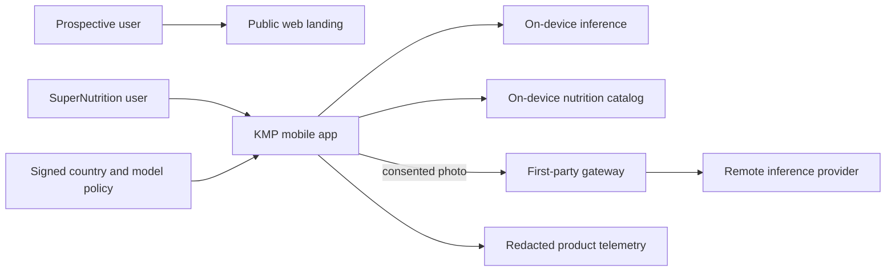
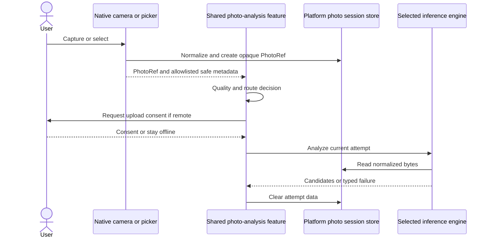
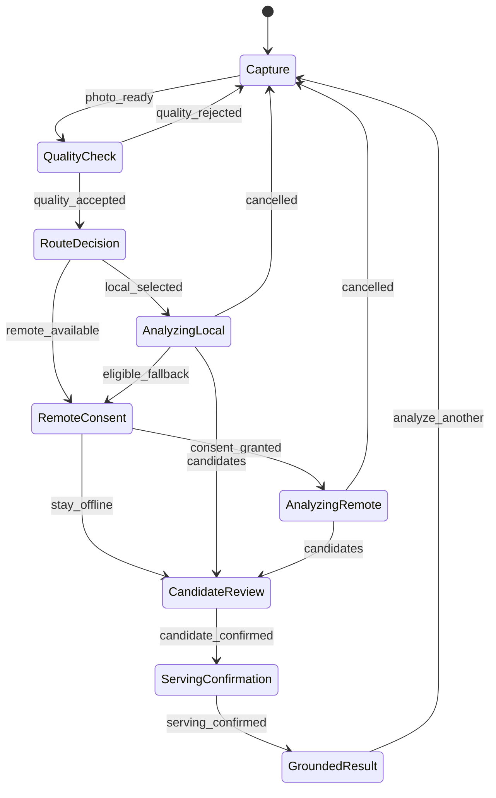
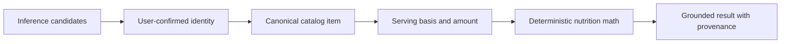

# SuperNutrition Solution Design

## 1. Purpose

This design turns the SuperNutrition product brief, PRD, and UX specification into an implementation boundary for a Kotlin Multiplatform Android and iOS app. It is intentionally specific about the seams that multiple developers must share, especially the contract between local and remote photo inference, while leaving model and provider selection to evidence gates.

The architecture spine is authoritative for implementation. This document explains the same decisions for team discussion and onboarding.

## 2. Product and technical context

SuperNutrition helps a user photograph or import a meal, identify likely foods, confirm the interpretation, set the serving, and receive nutrition grounded in an approved database. It is not a diagnostic or fully automatic calorie-estimation product. The first release must preserve user control and show assumptions rather than manufacture certainty.

The commercial audience is a reversible Tier-1 reference cohort: the United States, Canada, the United Kingdom, Australia, and New Zealand. This is not a final legal launch list. It gives research and planning a concrete frame for food catalogs, measurement conventions, provider regions, privacy copy, pricing, and culturally representative evaluation. Gate G-1 freezes the actual launch countries.

## 3. Architectural drivers

The main drivers are:

- Android and iOS with shared Kotlin logic and Compose UI wherever it is a good fit.
- Native camera and photo access without leaking platform objects into common code.
- Multiple local inference solutions selected by device capability.
- Remote inference as a separate implementation and deployment path.
- Independent local and remote teams that integrate through one versioned contract.
- Explicit consent before every remote photo transfer.
- Database-grounded numeric nutrition; inference never supplies nutrient values.
- Real-device evidence for camera, performance, memory, and local-model support.
- Country-aware data and policy, independent of display language.
- One monorepo with independently owned `mobile/`, `web/landing/`, and
  `backend/mobile-api/` products integrated only through `contracts/`.
- One testable identity contract: `SuperNutrition` in the installed app and
  product UI; `SuperNutrition AI nutritionist` only as the exact Apple App
  Store and Google Play listing title.
- Minimal interaction with safe defaults: the shortest practical happy path,
  allowlisted visible/editable/reversible defaults, and explicit decisions
  wherever a shortcut could change privacy, safety, or truth. Approved policy
  resolves legal/provider jurisdiction; the consent surface shows it before the
  user authorizes transfer.
- Agent-assisted implementation constrained by stories and architecture decisions.
- GiphySearch-derived module, lint, build, and test practices adapted to KMP and strengthened with coverage, dependency, macOS, and real-device gates.

## 4. System view



The landing site is a separate public product and does not share runtime source
or credentials with mobile or backend. The mobile app is useful without remote
upload: it can quality-check, attempt eligible local inference, accept manual
correction, and resolve confirmed items against an installed nutrition catalog.
Remote inference is an optional attempt-level route through
`backend/mobile-api/`, not an architectural prerequisite for basic use.

## 5. Module and team boundaries

| Area | Module or deployment | Primary owner | Inputs | Outputs |
| --- | --- | --- | --- | --- |
| Shared Engine contract | `mobile/domain/inference` | contract owner | versioned value types | engine interface, candidates, capability, canonical compatibility fixtures |
| Workflow and routing | `mobile/domain/photo-analysis` | orchestration owner | events, inference and nutrition ports | immutable state, RoutePolicy, consent/fallback decisions, effects, attempt coordination |
| Local Android | `mobile/inference/local-android` | Android local-inference developer | `PhotoContentSource`, model manifest | contract-v1 evidence |
| Local iOS | `mobile/inference/local-ios` | iOS local-inference developer | `PhotoContentSource`, model manifest | contract-v1 evidence |
| Remote mobile | `mobile/inference/remote` | remote mobile developer | consented photo, pinned API contract | contract-v1 evidence |
| Mobile API contract | `contracts/mobile-api` | independent cross-product contract owner | reviewed schemas and released-version matrix | immutable content-addressed language-neutral release |
| Mobile backend | `backend/mobile-api` | backend/remote-inference developer | authenticated request and contract artifact | normalized provider evidence |
| Public landing | `web/landing` | web owner | approved product/market content | public accessible site |
| Android/iOS photo platform | `mobile/platform/*` | platform developers | native camera/picker/permission APIs | leased PhotoRef and normalized content |
| Nutrition contracts/data | `mobile/domain/nutrition`, `mobile/data/nutrition` | nutrition owners | confirmed item, approved packages | grounded nutrition result |
| Product UI/composition | `mobile/feature/photo-analysis`, `mobile/apps/*` | KMP/mobile platform | domain state and concrete adapters | Compose product and thin hosts |
| Reusable test/evidence | `mobile/testing/*`, `mobile/evaluation/harness` | test and QA/ML owners | fixtures, corpus, device matrix | contract and outcome reports |

Local and remote mobile code do not import one another. Neither team owns
`RoutePolicy`: `mobile/domain/photo-analysis` depends one-way on the
contract-only `mobile/domain/inference`. Mobile and backend do not import one
another and neither owns the authoritative contract; each compiles and tests
independently against the same pinned `contracts/mobile-api` release and the
complete supported version-skew matrix. The web landing product has no source,
workspace, runtime, configuration, credential, artifact, or deployment
dependency on either and stays functional when the mobile backend is absent.
Android local, iOS local, remote mobile, backend, and landing work can therefore
proceed as separate stories. `mobile/apps/androidApp` alone starts Android Koin;
`mobile/apps/sharedKit` exports the idempotent iOS bootstrap used by the thin
iOS host.

## 6. Shared inference contract

The contract is small enough to keep every engine interchangeable:

```kotlin
interface PhotoInferenceEngine {
    val descriptor: EngineDescriptor

    suspend fun capability(
        context: InferenceContext,
    ): EngineCapability

    suspend fun analyze(
        request: PhotoInferenceRequest,
    ): PhotoInferenceResult
}
```

This is illustrative shape, not generated implementation. The definitive types are created by the contract story.

### Request invariants

- `contractVersion` is `1`.
- `attemptId` is opaque and unique.
- `photo` is a platform-neutral `PhotoRef`.
- `CatalogCountry`, `MarketJurisdiction`, `ProcessingRegion`, locale, and
  permitted route are immutable for the attempt.
- The adapter reads bytes only through `PhotoContentSource`.
- The engine receives no nutrition catalog and cannot emit numeric nutrients.

The contract module owns the serialized field names, namespace-qualified identifiers, unknown-value behavior, and compatibility matrix. It publishes canonical JSON and in-memory fixtures. Mobile local, mobile remote, gateway, and evaluation implementations must consume those fixtures unchanged; they do not maintain copied schemas.

### Capability states

- `Ready`: the engine can accept an attempt now.
- `ModelRequired`: a compatible optional model must be installed.
- `Downloading`: an approved model activation is in progress.
- `TemporarilyUnavailable`: retry may work later.
- `Unsupported`: this device/OS/config combination cannot run the engine.

Capability reports include engine and model version, relevant compatibility tier, and a human-safe reason code. They contain no device fingerprint.

### Candidate evidence

Each candidate contains:

- canonicalization hints and localized display label;
- a per-engine calibrated confidence band;
- visible interpretation assumptions such as preparation state or mixed dish;
- provenance: engine, model/provider deployment, contract version, and completion time;
- optional regions or components detected in the image;
- no calories, macros, micronutrients, or implied serving mass.

Confidence is meaningful only within the same calibrated engine/model version. The router must not compare unrelated raw scores.

### Failures

Failures are typed into invalid input, quality rejected, model unavailable, consent required, network unavailable, remote rejected, timed out, rate limited, incompatible contract, and internal failure. Each failure carries recoverability and the next permitted user action. Coroutine cancellation is not converted to a failure.

## 7. Photo lifecycle and platform integration



Android adapters use platform camera/photo APIs; iOS adapters use AVFoundation and PhotosUI. Compose renders product-owned screens on both platforms. UIKit or Android views may be embedded only where a native capture surface is required.

Normalization is a privacy boundary, not just an image-format conversion. The
platform adapter strips EXIF, GPS, and all non-essential metadata before it
creates the normalized PhotoRef content and before any consent receipt or
remote request digest is computed. `safe metadata` in the sequence diagram
means only an explicit allowlist such as dimensions, orientation, color space,
and contract version; it never means the source file's metadata map.

`PhotoRef` is an opaque identifier, not a URI. It is a lease scoped to one attempt. Cleanup atomically revokes the lease, is idempotent, and runs on success, failure, cancellation, expiry, and app restoration. External effects carry stable effect and attempt IDs; the app-root runner records at-most-once execution for transfer-start effects so restoration cannot duplicate an upload. The platform session store may use a short-lived encrypted file when bytes cannot remain in memory. No shared state contains a platform image object.

The native bridge contract also owns disposal, permissions, rotation, focus/zoom, spoken framing and quality guidance, captured-image description, focus restoration, target sizes, and error semantics. These behaviors require real-device VoiceOver and TalkBack evidence.

## 8. State and navigation

The feature has one reducer with immutable state, events, and one-time effects. Its transition contract also covers Back, photo replacement, app background/restore, effect acknowledgement, retry eligibility, manual alternatives, and no-nag behavior after remote consent is declined. Its major states are:



Recoverable errors are substates with an allowed next action rather than separate navigation destinations. Decompose holds only route boundaries and component lifecycle. The feature reducer owns the photo-analysis workflow, preventing route stacks from becoming a second state machine.

An adapter response is accepted only when its attempt token is still current. Cancellation first invalidates the token, then asks the adapter to release resources. A late callback can therefore never reopen a result.

Remote transfer has explicit `PreTransfer`, `Transferring`, and `Transferred` states. Pre-transfer cancellation sends no bytes. Transferring cancellation aborts transport and downstream work. Transferred cancellation suppresses results and requests deletion but does not claim to recall bytes already sent.

Compose and native bridge presentation share an accessibility/localization contract: semantic roles, contrast and non-color cues, dynamic type/font scaling, text expansion, bidi, localized numbers and units, reduced motion, target sizes, neutral externalized copy, spoken camera guidance, and focus restoration. Real-device VoiceOver and TalkBack tests cover the Compose-to-native handoff.

Interaction budget is part of the state contract, not a visual afterthought. The
reducer may auto-advance only reversible local/UI transitions. The immutable
`contracts/interaction-policy/v1` schema is owned by its contract slice.
`mobile/core/config` owns contract-neutral `ConfigurationSnapshot`,
`MarketPolicyResolver`, `InteractionDefaultPolicy`, `DefaultResolutionInput`,
`DefaultResolution`, and `DefaultResolver`; the resolver consumes a catalog
serving input but never imports domain types. `mobile/domain/nutrition` owns the
`CatalogServingDefaultSource` port, which can return an immutable atomic
unit-and-amount serving fact only after canonical-item confirmation. The
photo-analysis reducer maps the resolution to domain-owned
`DefaultProposal`/`DefaultDecision` events, enforces proposal IDs, monotonic
revisions, snapshot/policy digest preconditions, idempotency, and invalidation
precedence, and owns the complete lifecycle. Compose presenters only render the
result. Undo restores the prior accepted value or clears the proposal according
to the event type; it never re-runs resolution. Policy-resolved jurisdiction is
read from the attempt snapshot and shown in remote-consent detail; the user
authorizes the resulting transfer rather than selecting a provider region.
Uncertain food identity and prohibited medical/allergen conclusions remain
explicit safe states and cannot be skipped by defaulting.

## 9. Routing

The router evaluates:

1. photo quality;
2. the immutable catalog country, market jurisdiction, processing region, and
   policy version;
3. local-engine capability;
4. remote availability and gateway/provider policy;
5. explicit consent for this attempt;
6. validated thresholds from Gate G-5.

The initial router can be implemented with fake engines before thresholds exist. Before G-5, it must use conservative named policies such as `LocalOnly`, `RemoteOnlyWithConsent`, or `ManualConfirmation`, not invented confidence cutoffs.

After a local attempt, the only remote-escalation triggers are local
unavailability, Local Engine abstention, or a Gate G-5 low-confidence result.
G-5 can tune a named low-confidence threshold but cannot turn an otherwise
successful high-confidence local result into a remote prompt. A user may
explicitly select another permitted route before local analysis; that is an
explicit choice, not policy escalation. The reducer records a typed
`RemoteEligibilityReason` for every remote offer.

Hybrid routing is accepted only if the evaluation shows it improves corrected accuracy or time to a grounded result over both local-only and remote-only routes. It is not assumed superior.

## 10. Nutrition authority

The flow is deliberately two-stage:



The nutrition catalog is versioned and country-aware. SQLDelight owns schema, queries, and migrations. A result records source dataset, dataset version, canonical food ID, serving basis, and visible assumptions. If no approved mapping exists, the app asks for correction or manual selection; it does not use an LLM-provided number as a fallback.

The catalog also owns namespace-qualified food and serving identifiers, conversion into SI-normalized decimal values, source precision, calculation precision, display rounding, and per-item-to-meal aggregation. Packages are signed, checksummed, license-identified, schema-compatible, staged, atomically activated, and rollback-capable. Golden fixtures cover every supported unit, ranges, rounding boundaries, and partially grounded meals so feature code cannot invent alternative math.

Each activated country profile retains an approved bundled or cached package for offline manual search. A failed update keeps the previous valid package.

Catalog sources, licensing, canonical IDs, unit conversion, country coverage, missing-record policy, and update cadence are Gate G-2.

## 11. Tier-1 country configuration

Catalog country, market jurisdiction, processing region, and language are
separate axes. A signed configuration snapshot resolves precedence from bundled
safe default to global release to environment to independent catalog and market-
jurisdiction overrides. One inference attempt retains the same validated
snapshot. If the user changes catalog or market jurisdiction during correction,
the reducer terminates that attempt, clears remote consent and mapped results,
preserves only visible candidate text, and starts manual grounding under a new
snapshot. Choosing a catalog never silently changes the processing region.

| Country-profile field | Example purpose |
| --- | --- |
| `catalogCountry` | nutrition package and food-catalog selection |
| `marketJurisdiction` | consent, privacy, and user-rights policy |
| `defaultLocale` | initial UI locale, user-overridable |
| `nutritionPackageId` | approved local database package |
| `measurementSystem` | display and serving defaults |
| `processingRegion` | permitted provider/gateway region, resolved from market policy |
| `consentCopyVersion` | reviewed photo-transfer explanation |
| `featurePolicyVersion` | route and availability controls |

The signed profile is remotely distributable but has a bundled safe default. Invalid, expired, incompatible, or unverifiable policy disables remote upload and preserves offline/manual flows. The actual launch country list remains Gate G-1.

The same snapshot carries default provenance for allowlisted locale, measurement
system, and a catalog proposal. A confirmed canonical item may be passed to the
nutrition-domain `CatalogServingDefaultSource`, which returns an immutable
catalog serving fact keyed to the snapshot; it is not a snapshot mutation or a
user preference. The protected
`mobile/config/quality/interaction-policy.toml` conforms to the immutable
`contracts/interaction-policy/v1` schema and defines each field's source
precedence, independent CatalogCountry/MarketJurisdiction/ProcessingRegion and
locale validity, provenance type, persistence scope, and invalidation keys. The
UI may use those values to remove repetitive choices only when the value is
deterministic for the active context; each value is labeled as a default,
editable, reversible, and invalidated when any policy-defined key changes
(policy/snapshot version or digest, CatalogCountry, nutrition package,
MarketJurisdiction, ProcessingRegion, locale, measurement system, canonical
food/serving ID, or attempt/session ID). A first-use catalog proposal is not
accepted for grounding or remote transfer
until the user confirms it. Food/preparation/serving corrections are session-
scoped in the MVP. A confirmed CatalogCountry is persisted only as the next
attempt's catalog context; changing it during an active attempt invalidates that
attempt and creates a new snapshot, while market jurisdiction and processing
region remain policy-resolved and non-user-selectable. The snapshot resolves approved market jurisdiction and
processing region for policy, but the UI must show them before transfer and
never derive or silently change them from locale/catalog.

Evaluation must include food and device diversity within the target countries. English-language support does not justify an American-only corpus. The 300–500+ item research corpus is a minimum seed and must include weighed portions, recipes and brands, raw/cooked states, oils and sauces, device/lighting variety, and leakage-resistant splits.

## 12. Local inference

Local inference is a port implementation, not a single universal library. Android and iOS may use different runtimes or models if they produce the same contract.

The selection process at Gate G-3 evaluates:

- OS and hardware compatibility;
- model download and storage size;
- cold and warm latency;
- peak memory and energy;
- quality-gate and classifier accuracy;
- support for cancellation and model rollback;
- behavior under app backgrounding and resource pressure.

The initial bundled path should be the smallest baseline supported by the evidence. Higher-capability paths are optional tiers. Platform convenience APIs such as system-provided models may become an additional tier, never the only supported contract.

Each selected model freezes color space, dimensions, normalization, taxonomy, and golden pixel/output parity fixtures. App-managed model downloads use checksum-verified inactive slots and atomic activation/rollback. Platform-managed models report their capability and immutable version; SuperNutrition can policy-disable them but does not claim to roll back binaries controlled by the operating system.

## 13. Remote inference and gateway

The KMP remote adapter uploads to a first-party gateway through a typed Ktorfit API over Ktor using platform client engines. Ktorfit owns the generated endpoint declarations and Ktor owns transport, engine, authentication, and pipeline configuration. The adapter knows the SuperNutrition envelope, not a provider schema. A signed build flavor fixes the gateway origin and trust-key set. An attested app installation exchanges for a short-lived token bound to environment, installation, request digest, and nonce; request IDs are one-time. The gateway supports rotation, revocation, replay detection, abuse throttling, and a compromise runbook. The design does not require an account before the first scan.

The gateway:

- authenticates an app/session token;
- validates size, type, dimensions, contract version, and country policy;
- rate-limits by privacy-preserving principal;
- invokes the selected provider adapter;
- maps provider output to contract-v1 evidence;
- emits only allowlisted operational telemetry;
- avoids durable raw-photo storage;
- disposes temporary bytes on every terminal path.

Development, staging, and production are distinct configurations and credentials. Production provider selection, deployment runtime, region mapping, retry policy, and commercial limits are Gate G-4.

Production enablement additionally requires a named service owner, SLOs, alerts, jurisdiction-specific data-flow inventory, retention/deletion and user-rights evidence across provider, caches, queues, backups, and failures, cost and rate-limit dashboards, incident/notification runbook, provider kill switch, configuration rollback, and a recorded rollback drill.

## 14. Model and configuration supply chain

Every model manifest contains:

- immutable model ID and semantic or content version;
- cryptographic checksum;
- supported engine/runtime and device predicates;
- input normalization and label-map versions;
- evaluation report identifier;
- activation and rollback target;
- package size and required free-space policy.

Activation verifies checksum, writes an app-managed package to an inactive slot, and switches atomically. A failed or incompatible activation keeps the previous app-managed version. Bundled models are immutable inside an app release. Platform-managed system models are capability-gated, not slot-managed; when disabled, a previous compatible bundled or app-managed engine remains usable. Remote provider deployment IDs follow the same provenance principle even though their distribution mechanism differs.

## 15. Privacy and security

The highest-risk data path is a user photo moving from capture to an inference engine.

Controls include:

- data minimization and an ephemeral attempt store;
- EXIF, GPS, and non-essential image metadata scrubbing before consent/digest;
- equal-prominence consent choices;
- no remote transfer before consent;
- TLS and server-side provider credentials;
- request validation and authenticated rate limits;
- signed country/model policy;
- no photo body, filename, path, user-entered food label, or request/response body in logs;
- allowlisted telemetry;
- deletion on all terminal paths;
- country/provider-region review before launch.

Threat modeling and mobile security review are required before remote production enablement. Privacy copy must describe the real provider chain and retention behavior selected at G-4.

## 16. Observability and product evidence

The attempt lifecycle emits redacted events such as:

- attempt started;
- quality accepted or rejected;
- route selected;
- consent granted or declined;
- engine terminal outcome;
- candidate confirmed, corrected, or abandoned;
- grounded result displayed.

Allowed dimensions include route, capability tier, duration and resource buckets, outcome, controlled candidate/correction action codes, source-coverage code, country-profile version, and model/catalog/config version IDs. They require the applicable beta consent. Server-side correction telemetry remains disabled until G-6. Filenames, paths, image bytes, free-form labels, headers, tokens, and transport bodies remain forbidden. A privacy review owns additions to the versioned allowlist.

The evaluation harness produces route-by-platform evidence for Android local, Android remote, iOS local, and iOS remote. Hybrid is additionally compared with local-only and remote-only. Real devices are mandatory for camera, local inference, memory, energy, and timing claims.

## 17. Test architecture

The testing pyramid is contract-first:

1. Common unit tests for reducer, router, serving math, configuration precedence/atomicity, and typed error mapping.
2. One shared `PhotoInferenceEngine` contract suite and canonical serialization fixtures applied to fake, Android local, iOS local, remote, and gateway adapters.
3. SQLDelight query and migration tests with approved fixture packages.
4. Ktor `MockEngine` plus Ktorfit generated-client tests for upload, cancellation, error envelopes, redacted logging, and version compatibility.
5. Platform integration tests for leased `PhotoRef`, at-most-once effects, cleanup, lifecycle, camera/picker bridges, and accessibility services.
6. Gateway contract, authentication, environment binding, security, retention, provider-adapter, kill-switch, and rollback tests.
7. Shared Compose UI contracts use the versioned robot DSL over `androidx.compose.ui.test.v2.runComposeUiTest` in `commonTest`; the same authored semantic, state, and bounded-layout contracts execute through `jvmTest`, `connectedAndroidTest`, and `iosSimulatorArm64Test`.
8. Active bootstrap runs only a non-product robot and packaged launch/DI smoke. When the first photo-analysis UI lands, an irreversible profile transition enables the closed catalog derived from all qualifying UJ-1 through UJ-4 paths and SM-9 dimensions and maps each scenario exactly once to one Maestro CLI 2.7.0 flow. Identical logical steps execute against non-distributable Android/iOS UI-acceptance apps using JavaScript `output` selector dictionaries, a `runScript` loader, platform-conditional locator loading, deterministic fixtures, and separate binary-bound network/privacy oracles.
9. A closed platform-contract catalog derived from NFR-9, NFR-13, AD-23, and UX requirements maps every applicable platform to shared or native evidence. The native-gap inventory binds Android instrumentation, XCTest/XCUIAutomation, and real-device acceptance with app/fixture/device/task digests, source invalidation paths, and maximum age.

Every compiled production source/class belongs to exactly one coverage
denominator. Each product's modules and deduplicated product aggregate are held
to at least 85% unit-test line and branch coverage, while every changed
production line and branch outcome must be covered. Unavoidable Native, Swift,
framework, and hardware behavior uses independently approved, expiring
executable equivalent evidence plus physical-device evidence.

Mobile test support follows the GiphySearch pattern under `mobile/testing/`
while concrete tests remain beside owned behavior. Cross-product contract
fixtures live in `contracts/mobile-api/`; backend or mobile-specific fixtures
stay inside their product tests. The AD-28 acceptance executables remain mobile
only and every distributable artifact is scanned to exclude their bindings.

The build and quality contract is centralized and fail-closed:

- `mobile/gradle/libs.versions.toml` owns mobile versions and floors;
- included `mobile/build-logic` convention plugins own mobile module policy;
- AGP 9 Android apps use built-in Kotlin, while Android-bearing KMP libraries use `org.jetbrains.kotlin.multiplatform` plus `com.android.kotlin.multiplatform.library`;
- settings reject project repositories and strictly verify/lock every resolvable dependency set without CI rewriting metadata;
- one protected inventory schema governs all products; web/backend remain in fail-closed no-production preselection until their atomic activation stories, while root tests reconcile every executable, dependency install, cache, runtime edge, and deployment;
- `qualityCheckJvmAndroid` is the read-only Linux task for Detekt/format, Android lint, common/JVM/Android host tests, the profile-selected robot suite's `jvmTest`, the pinned Kover line/branch variant, canonical fixtures, dependency integrity, and forbidden edges/plugins;
- `qualityCheckApple` is the read-only macOS task for the same profile-selected robot suite's `iosSimulatorArm64Test`, other KMP iOS tests, framework export/link, native bridge tests, Xcode build-for-testing, simulator smoke, and Apple dependency resolution;
- `qualityFormat` is the only mutating formatting or Detekt-autocorrect entrypoint and never runs in CI;
- both host task requests prove configuration-cache store and reuse with problems failing; local quality gates remain authoritative and hosted status enforcement is optional;
- An optional GitHub Actions adapter can trigger on every branch push and pull request without path filters and run four mobile jobs plus `quality-web-landing` and `quality-backend`; `ci-required` directly needs exactly all six, uses `always()`, and validates same-SHA root-boundary, root-tool inventory, product-lifecycle/inventory, contract catalog, released-version matrix, and product evidence fingerprints when hosted;
- the Android UI job runs `connectedAndroidTest` and the same Maestro inventory as iOS. Jobs provision pinned devices, install unique UI-acceptance app IDs, checksum-pin and version-check Maestro 2.7.0, select the explicit device, and publish JUnit plus allowlisted short-retention artifacts. Platform files load only application identity and locator dictionaries; logical action/assertion sequences cannot diverge;
- AD-38 is optional hosting governance: private-repository rulesets, required `ci-required`, and a trusted read-only policy auditor may be added when available, but they do not block production implementation or release;
- mandatory fault/conformance scenarios prove cancellation, consent, logging, replay, cleanup, and deletion semantics beyond aggregate coverage;
- journey evidence records schema/policy/config versions and digests,
  proposal/decision IDs, resolved-value digest, tap/scroll/field/choice counts,
  bounded text-entry/choice-surface/recovery events, default provenance,
  lifecycle outcome, and override results; per-journey approved maxima are
  enforced, and a low count cannot compensate for hidden consent, jurisdiction,
  or uncertainty behavior;
- negative Gradle TestKit fixtures prove that the build gate rejects forbidden repositories/dependencies/edges, missing tests/coverage, testing leakage, and hidden autocorrect;
- real-device platform claims remain story-gated and cannot be replaced with simulator evidence.

The scaffold uses Detekt and its ktlint wrapper at 2.0.0-alpha.5 and Kover 0.9.8. Detekt is deliberately pre-release because 1.23.8 targets the older Kotlin 2.0/Gradle 8 generation; AD-16 tracks replacement by the first compatible stable Detekt 2.x. Kover evidence covers measurable JVM and Android host-test bytecode through one explicit merge project and report variant, not Kotlin/Native or device tests; Native and device evidence is published separately.

## 18. Delivery order

The architecture supports the following dependency-aware implementation order:

1. Create the `mobile/`, `web/landing/`, `backend/mobile-api/`, and independently owned `contracts/` roots; add distinct owners, protected root-policy/product-inventory schemas, mobile `scaffold-pending` plus web/backend `preselection` lifecycle gates, and six-job every-push CI evidence.
2. Keep AD-38 hosting governance optional; validate checked-in workflows and ownership locally without claiming external enforcement.
3. Execute the implementation guide's disjoint mobile scaffold sequence: build policy, bootstrap quality profile, bootstrap Maestro policy, scaffold probe, Compose support, sharedKit, Android host, iOS host, then lifecycle activation. Publish only non-product bootstrap Android/iOS/Xcode/host evidence through the local quality entrypoints and keep mobile `scaffold-pending` until the local activation gates succeed.
4. Select and prove pinned web-landing and backend toolchain tuples in separate atomic AD-37 activation stories without adding cross-root dependencies.
5. Publish contract v1 through the independent contract owner, then implement mobile/backend consumers and fakes against the released-version matrix.
6. Implement the photo-analysis reducer and non-visual state harness.
7. Build `PhotoRef` and native capture/import bridges.
8. Build nutrition catalog schema, fixtures, provenance, and serving math.
9. Close G-2 through G-4 for production nutrition, local, and remote selections.
10. Build local Android, local iOS, mobile remote, gateway, and approved catalog streams independently.
11. Run the G-5 corpus evaluation and calibrate routing.
12. Approve UX-A1 and screen mocks, ensure reducer/ports and dependencies are committed, then execute the guide's full first-feature handoff: feature, core UI IDs, build registration, quality profile/catalogs, Maestro flows, sharedKit, Android host, and iOS host as separate owner-scoped invocations. The combined candidate atomically switches from bootstrap to photo-analysis only when the full Android/iOS matrix passes.
13. Complete G-1 launch policy, decide G-6 correction retention, finish privacy/security review, and collect real-device evidence.

This sequence permits scaffolding, shared contracts, fakes, and evaluation tools before model/provider commitments. Production inference stories are not ready until their gates have evidence.

## 19. Open gates

| Gate | Blocks | Required exit evidence |
| --- | --- | --- |
| G-1 Tier-1 launch sequence | public store launch | country order, language, units/labels, jurisdictions and claims |
| G-2 Nutrition Source packages | grounding beyond fakes | licensed, signed country packages and provenance fixtures |
| G-3 local capability/device matrix | production local adapters | real-device runtime/model/resource benchmark |
| G-4 remote gateway/provider | production remote release | API, provider, region, DPA, cost, abuse and operations decision |
| G-5 evaluation thresholds | accuracy claims and hybrid routing | approved corpus and local/remote/hybrid/manual comparison |
| G-6 correction telemetry retention | server-side correction telemetry | consent, schema, purpose, retention/deletion, region and rights |
| UX-A1 and five mocks | visual UI stories | approved tokens and responsive/accessibility mocks |

## 20. Verified stack seed

The initial mobile version catalog is seeded with Kotlin/KMP 2.4.10, Compose Multiplatform 1.11.1 and `org.jetbrains.compose.ui:ui-test:1.11.1`, AndroidX Compose device-test artifacts 1.11.2, Gradle 9.5.0, Android Gradle Plugin 9.1.0, JDK 21, Android compile/target SDK 36, Android Build Tools 36.0.0, Ktor 3.5.1, Ktorfit 2.7.4, SQLDelight 2.3.2, Koin 4.2.2, Decompose 3.5.0, Detekt/ktlint-wrapper 2.0.0-alpha.5, Kover 0.9.8, and checksum-pinned Maestro CLI 2.7.0. The install floor starts at Android API 23. Xcode 26.4.1 on macOS 26.2 or newer, its XCTest/XCUIAutomation stack for native gaps, and an iOS 15 deployment target complete the bootstrap tuple.

These are cold-start mobile pins, not proof that `mobile/` builds. The mobile
scaffold story must compile common, Android, and iOS targets and record CI
evidence. Separate web and backend bootstrap stories select and prove their own
pinned tuples; no framework is implied by the monorepo directory decision.
Checked-in product manifests then become authoritative, and tuple upgrades are
separate reviewed changes.

Primary verification sources:

- [Kotlin Multiplatform compatibility guide](https://kotlinlang.org/docs/multiplatform/multiplatform-compatibility-guide.html)
- [Compose Multiplatform compatibility and versions](https://kotlinlang.org/docs/multiplatform/compose-compatibility-and-versioning.html)
- [Ktor releases](https://ktor.io/docs/releases.html)
- [Ktorfit documentation and compatibility](https://foso.github.io/Ktorfit/)
- [Ktorfit source and package modules](https://github.com/Foso/Ktorfit)
- [SQLDelight 2.3.2](https://github.com/lysine-dev/sqldelight/releases/tag/2.3.2)
- [Koin 4.2.2](https://github.com/InsertKoinIO/koin/releases/tag/4.2.2)
- [Decompose 3.5.0](https://github.com/arkivanov/Decompose/releases/tag/3.5.0)
- [Gradle Java compatibility](https://docs.gradle.org/current/userguide/compatibility.html)
- [Android Studio and AGP compatibility](https://developer.android.com/studio/releases)
- [Xcode SDK and system requirements](https://developer.apple.com/xcode/system-requirements/)
- [Kover Gradle plugin](https://kotlin.github.io/kotlinx-kover/gradle-plugin/)
- [Detekt compatibility table](https://detekt.dev/docs/introduction/compatibility/)
- [Android built-in Kotlin migration](https://developer.android.com/build/migrate-to-built-in-kotlin)
- [Android KMP library plugin](https://developer.android.com/kotlin/multiplatform/plugin)
- [Compose Multiplatform UI testing](https://kotlinlang.org/docs/multiplatform/compose-test.html)
- [Compose Multiplatform 1.11 test API updates](https://kotlinlang.org/docs/multiplatform/whats-new-compose-111.html)
- [Maestro documentation](https://maestro.mobile.dev/)
- [Maestro CLI 2.7.0](https://github.com/mobile-dev-inc/Maestro/releases/tag/cli-2.7.0)
- [Maestro page-object pattern](https://docs.maestro.dev/examples/recipes/implementing-the-page-object-model-pom)
- [Apple XCUIAutomation](https://developer.apple.com/documentation/XCUIAutomation)
- [GitHub Actions workflow syntax](https://docs.github.com/en/actions/reference/workflows-and-actions/workflow-syntax)
- [Pinned GiphySearch engineering reference](https://github.com/ajdevy/GiphySearch/tree/16bec3a193a2793db29e1f6f10f9a72e2b25656d)
