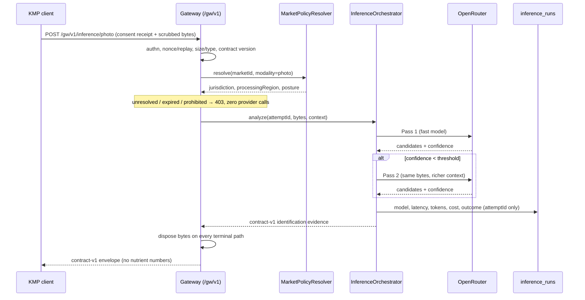
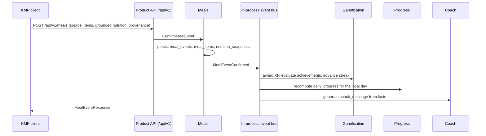

# 1. System Architecture Overview

## 1.1 What this service is

`backend/mobile-api` is a Node.js + TypeScript DDD modular monolith on
PostgreSQL and Redis. It is one of three independent product roots and owns its
own dependencies, tests, quality entrypoint, artifact, deployment, credentials,
and rollback (AD-36).

It serves two consumers with genuinely different requirements, and the first
architectural decision is to stop pretending they are one API.

## 1.2 Decision: two surfaces, one deployment

The stage brief describes a full product backend — meals, journey, progress,
achievements, coaching. The architecture spine describes `backend/mobile-api`
as the first-party inference gateway (AD-13, AD-21). Both are real. They are
not the same surface.

| | **Surface A — Inference Gateway** | **Surface B — Product API** |
| --- | --- | --- |
| Base path | `/gw/v1` | `/api/v1` |
| Consumer | KMP client remote inference adapter | KMP client product screens |
| Contract | Pinned `contracts/mobile-api` release | URL-versioned REST, own contract release required |
| Versioning | Contract release; breaking change is a new major release with coexistence window | URL major version; additive minor changes |
| Carries user content | Yes — scrubbed photo bytes, transiently | No — identifiers, text, numbers |
| Durable user content | **None** | Meal events, progress, achievements |
| Governing ADs | AD-8, AD-13, AD-14, AD-17, AD-21, AD-24, AD-41 | AD-14, AD-33, AD-36, AD-40 |
| Delivered by | E4.3 | Post-E4 product epics |
| Auth | Attested installation → short-lived scoped token | Same token, different scope claim |

**Why not two services?** At MVP volume, two deployables buy operational cost
and a distributed transaction we do not need, and buy no isolation we cannot
get from module boundaries. The split that matters is the *contract* split, and
that is enforced at the module and route layer.

**Why not one surface?** Because their invariants contradict. Surface A must
never durably store what it receives; Surface B exists to durably store what it
receives. Fusing them makes "no raw photo retention" a code-review promise
instead of a structural property. Keeping them apart makes the gateway's
storage-free property provable: the gateway modules have no repository
dependency at all.

**Split criterion, recorded now:** extract Surface A into its own deployable
when any of these becomes true — gateway p99 latency is coupled to Product API
load, provider spend requires independent scaling, or a market's residency
posture requires the gateway to run in a region the product database may not.
Until then, one deployment.

## 1.3 Request paths

### Remote inference (Surface A)



Bytes exist only inside one request's lifetime, in memory or an encrypted
scratch buffer, and are destroyed by a `finally` path that runs on success,
error, timeout, and cancellation alike. Nothing on this path touches a
repository.

### Meal logging (Surface B)



`nutrition_snapshots` is written from what the client sends, with its catalog
provenance. The backend does not recompute it. See §1.5.

## 1.4 Layering

Dependencies point inward only (AD-1). No inward layer may reference an outward
one.

```
presentation  →  application  →  domain
                      ↓              ↑
               infrastructure ────────┘
                (implements domain ports)
```

- **domain** — entities, value objects, port interfaces, domain events. No
  framework imports, no SQL, no HTTP, no Drizzle, no Redis, no OpenRouter.
- **application** — use cases, commands, queries, orchestration. Depends on
  domain ports only.
- **infrastructure** — adapters implementing domain ports: Drizzle
  repositories, Redis caches, OpenRouter client, USDA client.
- **presentation** — routes, controllers, Zod schemas, request/response DTOs.
- **composition root** — the only place concrete adapters are chosen.

`domain` importing anything from `infrastructure` is the single most common way
this design decays. Document 4 specifies the lint rule that makes it fail the
build rather than a review.

## 1.5 Decision: this backend is not the nutrition authority

AD-7 makes the versioned on-device catalog the only source of displayed
nutrient numbers, and AD-19 makes its calculation canonical. The stage brief
asks the backend to own `nutrition_snapshots` and a USDA provider. Reconciled:

- For a client-created meal, the client sends the grounded result it computed
  and the user confirmed. The backend **persists it verbatim** with its
  `catalogSource`, `datasetVersion`, `servingBasis`, and assumptions. It never
  recalculates, substitutes, or "corrects" those numbers.
- The backend's USDA integration is scoped to **catalog package curation and
  publication** — building the signed, versioned packages the client consumes —
  plus a server-side *lookup* returning catalog facts and provenance for text
  entry where no local package covers the term.
- That server-side lookup returns **facts, not verdicts**. It is gated on G-2
  and requires its own contract release before any client depends on it.

This keeps a single answer to "why does this number say 214 kcal": one catalog,
one dataset version, one calculation. Two calculators that agree today diverge
the first time one is patched.

## 1.6 Decision: `TEST_MODE` is fenced, not a mode

The stage brief requires auth infrastructure that runs in test mode, handing
out sessions without verification. AD-21 requires attested installations,
short-lived scoped tokens, one-time request IDs, and replay detection. A flag
that disables authentication is the exact failure AD-21 exists to prevent, so
it is constrained structurally rather than by convention:

- The process **refuses to start** with `TEST_MODE=true` when `NODE_ENV` is
  `production` or the resolved gateway environment is `production`. This is a
  boot assertion, not a warning.
- Test-mode tokens carry `authMode: "test-mode"`. Every token consumer sees it.
- The gateway's remote-transfer path **rejects test-mode tokens** unless the
  resolved market is a designated non-production fixture market. Test mode can
  never cause a real user photo to reach a real provider.
- Startup logs a persistent banner; `/health/ready` reports `authMode` so no
  environment can be in test mode unnoticed.

Full flow in document 9, §9.2.

## 1.7 Cross-cutting properties

| Property | Mechanism |
| --- | --- |
| Provider replaceability | `InferenceProvider` port; OpenRouter is one adapter; model IDs are configuration (AD-9). No business module imports a provider SDK. |
| Grounded nutrition | Numbers carry catalog source and dataset version or they are not displayed (AD-7). |
| No durable photos | Gateway modules have no repository dependency; disposal on every terminal path (AD-8). |
| Fail-closed markets | Absent, `unresolved`, or expired posture permits no remote inference of any modality (AD-41). |
| Allowlisted telemetry | `inference_runs` is keyed by opaque `attemptId` and holds no user foreign key, no prompt text, no response bodies (AD-14). |
| Observability | Correlation ID per request, `attemptId` per inference, structured Pino logs against a field allowlist. |
| Reversibility | Every provider and model choice is configuration with a recorded rollback target (AD-9, AD-24). |

## 1.8 Deployment shape (MVP)

One container image, horizontally scalable, stateless. Managed PostgreSQL with
point-in-time recovery. Managed Redis for rate limits, nonce/replay records,
idempotency keys, and catalog-lookup caching — never for user content.

Three environments with distinct configurations, credentials, and provider keys:
`development`, `staging`, `production`. A signed client build flavor fixes which
gateway origin it may talk to (AD-21); a client cannot be pointed at production
by configuration alone.

Production enablement is gated on G-4 and on the AD-24 checklist — named service
owner, SLOs, alerts, deletion and user-rights evidence, cost and rate-limit
dashboards, jurisdiction data-flow inventory, incident runbook, provider kill
switch, configuration rollback, and a recorded rollback drill. Documents 9 and
10 carry these as acceptance criteria, not aspirations.

## 1.9 What this service must never do

A short list, because each item is a boundary that erodes quietly:

1. Durably store, log, cache, queue, or back up raw photo bytes.
2. Emit a nutrient number that lacks a catalog source and dataset version.
3. Let a business module import an AI provider SDK or a provider-shaped type.
4. Let a market's remote path open without an explicit, in-date, per-modality
   posture and a consent receipt bound to the scrubbed payload digest.
5. Import source from `../../mobile` or `../../web/landing`, or depend on their
   build tasks, caches, or artifacts (AD-36).
6. Write to `contracts/`. It is a consumer of pinned immutable releases.
