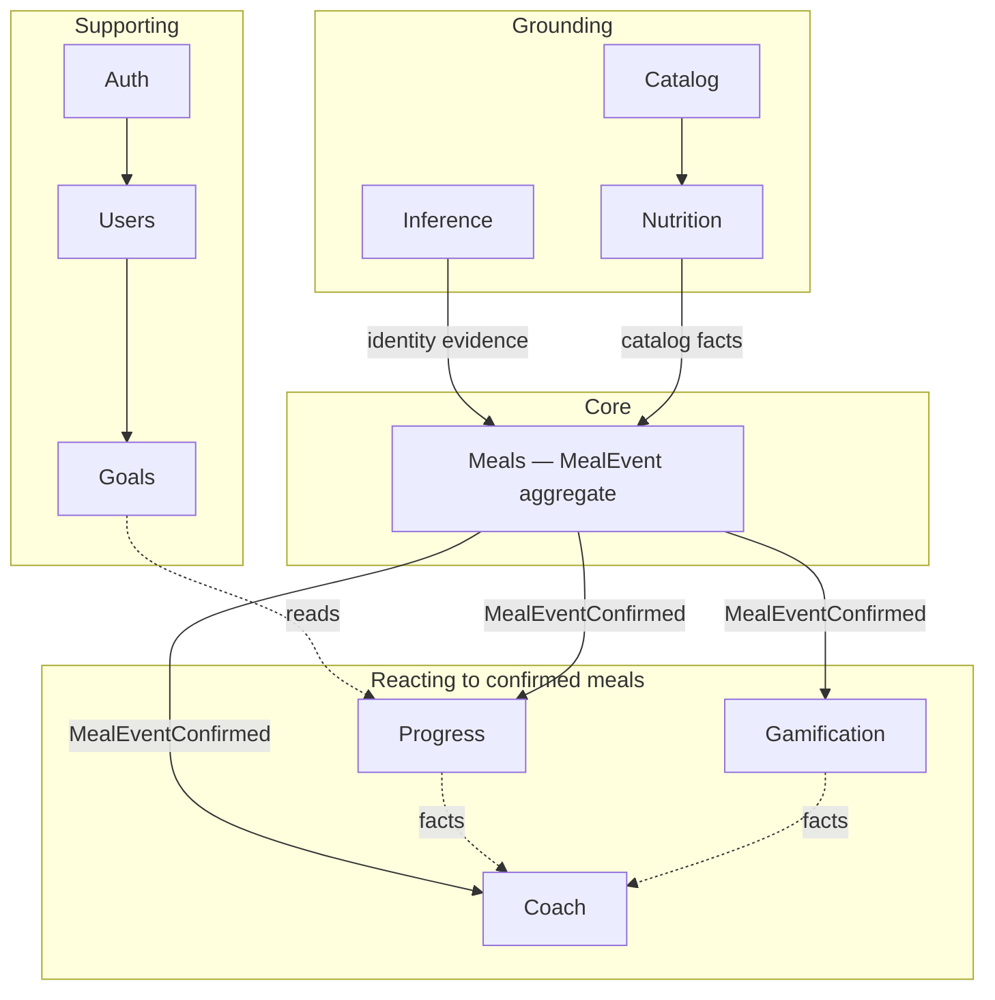

# 2. Domain Architecture (DDD boundaries)

## 2.1 The core entity

`MealEvent` is the aggregate root of the product. Photo, manual, and voice are
three ways to *create* one; none of them is a separate concept downstream. Every
other product domain either produces a `MealEvent`, reacts to one, or reports on
a set of them.

The practical test applied throughout: if a feature cannot be expressed as
"something that happens to, or because of, a `MealEvent`", it does not belong in
this product's core.

## 2.2 Domain map



Solid arrows are dependencies or events. Dotted arrows are read-only fact
queries through a published contract.

## 2.3 Domains

### Auth — supporting

**Owns:** credentials, installation attestation, token issuance and rotation,
refresh-token lineage, session revocation, replay/nonce state, `TEST_MODE`
fencing.

**Does not own:** user profile, preferences, goals. Auth answers "is this caller
who they claim, and what scope do they hold" and nothing else.

**Key rule:** Auth is the only domain that mints or validates tokens. No other
module reads a JWT.

### Users — supporting

**Owns:** user identity record, profile attributes, locale and measurement
preferences, account lifecycle including deletion, consent-receipt records.

**Key rule:** Users owns the deletion cascade. When a user is erased, Users
orchestrates it; every other domain exposes an erasure port. This is a
user-rights requirement under AD-24, not a nicety.

### Goals — supporting

**Owns:** `UserGoal` — targets for calories and macros, activity level, goal
type, validity period.

**Key rule:** Goals are **versioned, not mutated**. Changing a target opens a new
validity period. Historical adherence must be computed against the goal that
was in force on that day, or every past week silently rewrites itself.

### Meals — core

**Owns:** `MealEvent` aggregate — `MealEvent`, `MealItem`, `MealEvidence`,
`NutritionSnapshot` as a value object of the confirmed event.

**Aggregate boundary:** one `MealEvent` with its items, evidence, and snapshot
is one transactional unit. Cross-meal operations are queries, never commands.

**Status lifecycle:**

```
pending ──▶ identified ──▶ confirmed
   │             │
   └────────────▶└──────────▶ failed
```

`confirmed` is terminal for nutrition purposes. A correction after confirmation
creates a new revision rather than mutating history — Progress and Gamification
have already reacted, and silently changing the fact they reacted to is how
streaks become unexplainable.

**Key rule:** only Meals writes meal data. Gamification and Progress *read* it.

### Inference — grounding

**Owns:** `InferenceProvider` port, `InferenceOrchestrator`, `InferenceResult`,
`ConfidenceScore`, `InferenceEvidence`, `inference_runs` telemetry.

**Does not own:** nutrient numbers. Ever. Inference returns food *identity*
evidence — ranked candidates, per-engine confidence, assumptions, provenance —
and the contract (`contracts/inference/v1`, `numeric_nutrition = false`) makes
that structural.

**Key rule:** no business module imports OpenRouter. Modules depend on the port;
the composition root binds the adapter.

### Nutrition — grounding

**Owns:** `NutritionProvider` port, `NutritionFact`, `FoodReference`,
`NutritionSnapshot` construction rules, unit conversion and rounding policy.

**Key rule:** every `NutritionFact` carries `catalogSource`, `datasetVersion`,
and `servingBasis`. A fact without provenance is not a fact and must not
serialize.

### Catalog — grounding

**Owns:** food catalog lookup and search, `CatalogMatch`, canonical
namespace-qualified food and serving IDs, catalog package metadata and
publication.

**Why separate from Nutrition:** Catalog answers "which food record is this";
Nutrition answers "what does that record mean for this serving". Keeping them
apart lets a second provider (Open Food Facts) be added as a Catalog concern
without touching calculation.

### Coach — reacting

**Owns:** `CoachMessage`, `CoachRecommendation`, `CoachContext`, message
selection rules and delivery cadence.

**Key rule — the important one:** *Coach never modifies facts.* It reads
Progress, Gamification, and Meals, and produces text. It has no write access to
any other domain's tables. Coach is a projection.

**Also:** Coach must not produce medical or allergen conclusions (AD-40). This
is a content constraint enforced in the message catalog and tested, not left to
prompt wording.

### Gamification — reacting

**Owns:** `Achievement`, `UserAchievement`, `Streak`, `XpTransaction`, and the
rule-evaluation engine.

**Key rule — no hardcoded achievements.** MVP ships First Meal, 3 Day Streak,
7 Day Streak, Healthy Week, Protein Hero. All five are *data*: an achievement
row carries a declarative criteria expression the engine evaluates. Adding the
sixth is a migration and a fixture, not a deploy of new branching code.

**Idempotency:** evaluation is keyed by `(userId, achievementId)` with a unique
constraint, and XP by `(userId, reason, refId)`. Replaying an event must never
double-award. Document 5 carries the constraints.

### Progress — reacting

**Owns:** `DailyProgress`, `WeeklyProgress`, `GoalProgress`, aggregation and
trend calculation.

**Key rule:** `daily_progress` is a **derived, rebuildable projection**. It is a
cache of a query over `meal_events`, and a maintenance job must be able to drop
and rebuild any date range from source. Aggregates that cannot be rebuilt become
their own source of truth by accident.

**Timezone:** aggregation uses the user's local day, stored explicitly per row.
A user who travels must not lose or duplicate a day, and a UTC-only design
guarantees they will.

## 2.4 Cross-domain communication

Three mechanisms, in order of preference:

1. **Domain events over an in-process bus** — for reactions. `MealEventConfirmed`
   is published by Meals; Gamification, Progress, and Coach subscribe. Handlers
   are idempotent and keyed by event ID, because at-least-once delivery is the
   only honest assumption once this bus is backed by a queue.
2. **Published contract interfaces** — for synchronous reads across domains. A
   domain exposes a narrow `contracts/` interface; consumers depend on that, not
   on the owner's internals.
3. **Direct repository access across domains** — forbidden. No module reads
   another module's tables.

Events carry identifiers and enough scalar context to act, never whole
aggregates. A handler that needs more re-reads through the owner's contract.

## 2.5 Transaction boundaries

- One command, one aggregate, one transaction.
- Domain events are collected during the transaction and dispatched **after
  commit**. Publishing inside the transaction means subscribers can observe
  state that later rolls back.
- Cross-aggregate consistency is eventual and must be visibly so: a meal is
  confirmed immediately; XP and progress land within the same request under
  normal load, but the API never promises they are already applied.
- Failure in a subscriber must not fail the command. Meal logging is the primary
  KPI; a broken achievement rule must not prevent a user from logging lunch.

## 2.6 Ubiquitous language

| Term | Means | Does not mean |
| --- | --- | --- |
| Meal Event | One eating occasion recorded by the user | A photo, a request, an API call |
| Candidate | A ranked food identity hypothesis from inference | A confirmed food |
| Canonical item | A catalog record the user confirmed | A model's label |
| Grounded result | Nutrition computed from a canonical item and confirmed serving | A model's estimate |
| Attempt | One inference lifecycle, opaque ID, at most one terminal outcome | A user session |
| Evidence | Provenance for how an identity or number was reached | The model's raw response |
| Snapshot | Nutrition frozen at confirmation, with dataset version | A live recomputation |
| Confirmation | The user asserting identity or serving | Acceptance of a default |

The last row matters for AD-40: a default that is never explicitly accepted has
not been confirmed, and must not advance into grounding or transfer.
