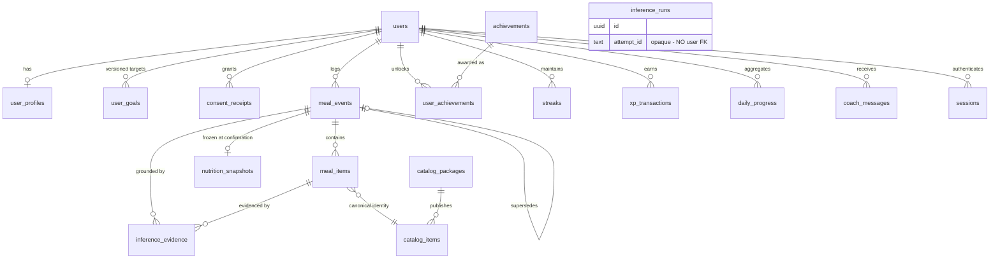

# 5. Database Design

PostgreSQL 16, Drizzle ORM, forward-only migrations via drizzle-kit.

## 5.1 Conventions

| Concern | Decision | Reason |
| --- | --- | --- |
| Primary keys | UUIDv7 (`uuid` column) | Time-sortable, so index locality is good without leaking a sequence count |
| Timestamps | `timestamptz`, UTC | One instant, no ambiguity |
| Local days | `date` + IANA `timezone` text, stored explicitly | A traveller must not lose or duplicate a day |
| Nutrients | `numeric(10,3)` | Float arithmetic on nutrients produces totals that do not match their parts |
| Enums | Postgres `enum` for closed sets; `text` + check for sets expected to grow | Adding an enum value is a migration; growth-prone sets should not be |
| Soft delete | `deleted_at timestamptz` on user-owned tables | Erasure needs a two-phase path with auditable evidence |
| JSON | `jsonb`, always with a documented shape | Queryable, indexable |
| Money | Integer micro-units (`bigint`), never float | Provider cost accumulates; rounding drift is real |
| Naming | plural snake_case tables, snake_case columns | Matches §3.5 |

## 5.2 ERD



`inference_runs` is deliberately drawn detached. It has no relationship to
`users` and that is a design requirement, not an omission — see §5.4.

## 5.3 Tables

### Identity and access

**`users`** — `id` PK, `external_ref` unique, `status` (`active|suspended|deleted`),
`created_at`, `updated_at`, `deleted_at`.

**`user_profiles`** — `user_id` PK/FK, `display_name`, `locale` (BCP 47),
`measurement_system` (`metric|imperial`), `timezone` (IANA), `updated_at`.

**`sessions`** — `id` PK, `user_id` FK, `installation_id`, `environment`,
`auth_mode` (`attested|test-mode`), `scope`, `refresh_token_hash`,
`refresh_family_id`, `issued_at`, `expires_at`, `revoked_at`, `revoked_reason`.

Refresh tokens are stored **hashed** (SHA-256). `refresh_family_id` groups a
rotation lineage so that presenting an already-rotated token revokes the whole
family — the standard detection for a stolen refresh token.

**`consent_receipts`** — `id` PK, `user_id` FK, `attempt_id`, `purpose`,
`modality` (`photo|text`), `payload_digest`, `market_jurisdiction`,
`processing_region`, `retention_version`, `configuration_version`,
`consent_copy_version`, `decision` (`granted|declined`), `decided_at`.

The digest binds the receipt to the **scrubbed normalized payload** (AD-8). The
payload itself is never stored.

### Goals

**`user_goals`** — `id` PK, `user_id` FK, `goal_type`, `target_calories`,
`target_protein_g`, `target_fat_g`, `target_carb_g`, `activity_level`,
`effective_from` (date), `effective_to` (date, null = current), `created_at`.

Constraint: at most one row per user with `effective_to IS NULL`, and no
overlapping periods — enforced with an exclusion constraint over a daterange.

### Meals

**`meal_events`** — `id` PK, `user_id` FK, `source` (`photo|manual|voice`),
`status` (`pending|identified|confirmed|failed`), `occurred_at` (timestamptz),
`local_date` (date), `timezone` (text), `meal_type`
(`breakfast|lunch|dinner|snack|unspecified`), `revision` (int, default 1),
`supersedes_id` (FK self, null), `attempt_id` (text, null),
`configuration_version`, `created_at`, `confirmed_at`, `deleted_at`.

**`meal_items`** — `id` PK, `meal_event_id` FK cascade, `position` (int),
`food_ref` (text, namespace-qualified), `display_name`, `serving_unit`,
`serving_amount` (numeric), `gram_weight` (numeric), `confidence` (numeric,
null for manual), `confirmed_by_user` (bool), `created_at`.

`confirmed_by_user` records Principle 2 in the data: user confirmation outranks
catalog data, which outranks AI inference.

**`nutrition_snapshots`** — `id` PK, `meal_event_id` FK unique, `catalog_source`,
`dataset_version`, `serving_basis` (jsonb), `calories`, `protein_g`, `fat_g`,
`carb_g`, `fiber_g`, `sugar_g`, `sodium_mg`, `per_item` (jsonb),
`origin` (`client-grounded|server-grounded`), `computed_at`.

`origin` is load-bearing. `client-grounded` rows were computed on-device from
the versioned catalog and are persisted verbatim (§1.5). `server-grounded` rows
come from the gated server lookup path and are distinguishable forever.

The one-to-one with `meal_events` is intentional: a snapshot belongs to a
confirmed event, and a correction produces a new event revision with its own
snapshot rather than mutating this one.

**`inference_evidence`** — `id` PK, `meal_event_id` FK, `meal_item_id` FK null,
`attempt_id`, `type` (`candidate|assumption|abstention|correction`),
`payload` (jsonb), `provenance` (jsonb: route, engineId, modelVersion,
calibrationVersion, contractVersion), `created_at`.

`payload` holds candidate labels, ranks, and confidences — the identity evidence
the contract permits. It never holds image bytes, image digests joinable to a
user, prompt text, or raw provider responses.

### Gamification

**`achievements`** — `id` PK, `key` unique, `name`, `description`, `icon_ref`,
`criteria` (jsonb), `xp_reward` (int), `active` (bool), `sort_order`,
`created_at`.

Seeded with the five MVP achievements. `criteria` example for 7 Day Streak:

```json
{ "type": "streak", "streakType": "daily_logging", "operator": ">=", "value": 7 }
```

Protein Hero:

```json
{ "type": "goal_adherence", "nutrient": "protein",
  "operator": ">=", "value": 1.0, "window": { "days": 1 } }
```

Adding an achievement is a seed row plus a rule-engine fixture. It is not a code
change, which is what "scalable achievement engine" has to mean in practice.

**`user_achievements`** — `id` PK, `user_id` FK, `achievement_id` FK,
`unlocked_at`, `evidence` (jsonb). **Unique `(user_id, achievement_id)`** — the
constraint that makes replay safe.

**`streaks`** — `id` PK, `user_id` FK, `type` (`daily_logging|goal_adherence`),
`current_count`, `longest_count`, `last_local_date`, `updated_at`.
Unique `(user_id, type)`.

**`xp_transactions`** — `id` PK, `user_id` FK, `amount` (int), `reason`,
`ref_id`, `created_at`. **Unique `(user_id, reason, ref_id)`.**

A ledger, not a counter. Balance is `SUM(amount)`, optionally materialized later
if it ever measures slow.

### Progress and coaching

**`daily_progress`** — `id` PK, `user_id` FK, `local_date` (date),
`total_calories`, `total_protein_g`, `total_fat_g`, `total_carb_g`,
`total_fiber_g`, `meal_count`, `goal_id` FK, `goal_adherence` (jsonb),
`computed_at`. Unique `(user_id, local_date)`.

Derived and rebuildable. `computed_at` plus a source watermark lets a
maintenance job detect and repair staleness.

**`coach_messages`** — `id` PK, `user_id` FK, `meal_event_id` FK null,
`type` (`motivation|recommendation|habit`), `message_key`, `params` (jsonb),
`locale`, `delivered_at`, `read_at`, `created_at`.

Stores a **`message_key` plus params**, not rendered prose. Localization belongs
to the client, and a stored English sentence cannot be re-rendered in Spanish.

### Catalog

**`catalog_packages`** — `id` PK, `package_id` unique, `catalog_country`,
`dataset_version`, `source` (`usda|off`), `checksum`, `license_id`, `size_bytes`,
`activated_at`, `rollback_target_id`, `status` (`staged|active|rolled-back`).

**`catalog_items`** — `id` PK, `package_id` FK, `food_id` (namespace-qualified),
`display_name`, `search_vector` (tsvector), `nutrients_per_100g` (jsonb),
`serving_options` (jsonb), `created_at`. Unique `(package_id, food_id)`.

### Telemetry

**`inference_runs`** — see §5.4.

## 5.4 `inference_runs` — the deliberate shape

The brief asks for model, confidence, duration, token usage, estimated cost,
success, and timestamp, for future model benchmarking. That is a good goal and
the table below serves it. One column that a natural design would include is
absent on purpose.

```
id                    uuid PK
attempt_id            text        -- opaque, NOT joinable to a user
pass_number           smallint    -- 1 or 2
provider              text        -- 'openrouter'
model_id              text        -- 'google/gemini-2.5-flash'
model_profile_version text
outcome               text        -- 'candidates' | 'abstention' | 'failure'
success                boolean
confidence            numeric(4,3) null
duration_ms           integer
duration_bucket       text        -- 'under-1s' | '1s-3s' | '3s-10s' | 'over-10s'
prompt_tokens         integer
completion_tokens     integer
estimated_cost_micros bigint
failure_code          text null   -- typed code, never a provider message
market_jurisdiction   text
processing_region     text
environment           text
created_at            timestamptz
```

**There is no `user_id`.** AD-14 permits an opaque attempt ID and forbids
telemetry that identifies content or people. A `user_id` here would turn an
operational metrics table into a per-person record of what they photographed and
when, joinable to `meal_events` by anyone with read access. Benchmarking needs
model, latency, cost, and outcome distributions — none of which require knowing
whose lunch it was.

Also absent, and equally deliberate: prompt text, raw provider responses,
candidate labels, image digests, headers, and free-form failure messages.
`failure_code` is a closed typed set.

Cost attribution per user, if it is ever genuinely needed, is a separate
G-6-gated design with its own consent and retention — not a column added here.

**Retention:** 90 days at full granularity, then aggregate to daily rollups by
`(model_id, outcome, environment)` and drop the rows.

## 5.5 Indexes

Every index below exists for a named query. Indexes without a query are
write-amplification with good intentions.

| Table | Index | Serves |
| --- | --- | --- |
| `meal_events` | `(user_id, occurred_at DESC)` | Journey feed, the hottest read |
| `meal_events` | `(user_id, local_date)` | Daily aggregation and rebuild |
| `meal_events` | `(user_id, status)` partial `WHERE deleted_at IS NULL` | Active meal queries |
| `meal_events` | `(attempt_id)` partial `WHERE attempt_id IS NOT NULL` | Attempt reconciliation |
| `meal_items` | `(meal_event_id, position)` | Aggregate load |
| `meal_items` | `(food_ref)` | "How often is this food logged" |
| `nutrition_snapshots` | unique `(meal_event_id)` | 1:1 enforcement |
| `inference_evidence` | `(meal_event_id)`, `(attempt_id)` | Provenance lookup |
| `user_goals` | `(user_id, effective_from DESC)` | `findActiveAt` |
| `user_goals` | exclusion on `(user_id, daterange)` | No overlapping periods |
| `daily_progress` | unique `(user_id, local_date)` | Upsert target and dashboard |
| `daily_progress` | `(user_id, local_date DESC)` | Trend windows |
| `user_achievements` | unique `(user_id, achievement_id)` | Idempotent award |
| `xp_transactions` | unique `(user_id, reason, ref_id)` | Idempotent grant |
| `xp_transactions` | `(user_id, created_at DESC)` | XP history |
| `streaks` | unique `(user_id, type)` | Upsert target |
| `coach_messages` | `(user_id, created_at DESC)` | Message feed |
| `sessions` | `(refresh_token_hash)`, `(refresh_family_id)` | Rotation and reuse detection |
| `sessions` | `(user_id, revoked_at)` partial `WHERE revoked_at IS NULL` | Active sessions |
| `consent_receipts` | `(user_id, decided_at DESC)`, `(payload_digest)` | Audit and binding check |
| `catalog_items` | GIN on `search_vector` | Food search |
| `catalog_items` | unique `(package_id, food_id)` | Identity |
| `inference_runs` | `(created_at DESC)`, `(model_id, created_at DESC)` | Benchmarking, retention sweep |

## 5.6 Migration strategy

**Forward-only.** No down migrations. A bad migration is corrected by a new
migration, because a down migration is written once, tested never, and run in an
incident.

**Expand / migrate / contract** for every breaking change, as three separate
deploys:

1. *Expand* — add the new nullable column or table. Old and new code both work.
2. *Migrate* — backfill in bounded batches; dual-write from application code.
3. *Contract* — drop the old column once no deployed version reads it.

**Rules**

- Migrations are checked in, reviewed, and immutable once merged.
- No `ALTER TABLE` that rewrites a large table during a deploy. Prefer a new
  column plus backfill.
- Indexes on populated tables use `CREATE INDEX CONCURRENTLY`, outside a
  transaction.
- Every migration runs against a restored production-shaped dataset in staging
  before production, with the timing recorded.
- Seed data (`achievements`, fixture markets) is idempotent and re-runnable.
- A migration touching `nutrition_snapshots` or `consent_receipts` requires
  explicit review sign-off: those rows are evidence, and losing them loses the
  ability to explain a past number or prove a past consent.

**Rollback** is a forward migration plus an application rollback to the previous
artifact. The AD-24 rollback drill exercises exactly this path, and it is not
considered complete until it has been performed and recorded.

## 5.7 Drizzle organization

```text
packages/database/src/schema/
├── index.ts                  re-exports all tables and relations
├── enums.ts                  shared pgEnum definitions
├── users.ts
├── user-profiles.ts
├── sessions.ts
├── consent-receipts.ts
├── user-goals.ts
├── meal-events.ts
├── meal-items.ts
├── nutrition-snapshots.ts
├── inference-evidence.ts
├── inference-runs.ts
├── achievements.ts
├── user-achievements.ts
├── streaks.ts
├── xp-transactions.ts
├── daily-progress.ts
├── coach-messages.ts
├── catalog-packages.ts
└── catalog-items.ts
```

Each file declares its table, its indexes and constraints, its `relations`, and
its inferred `Select`/`Insert` types. Relations live with the table that owns the
foreign key.

**Repositories are the only Drizzle consumers.** `packages/database/src/repositories`
holds the adapters implementing the domain ports from document 4. Nothing in
`application` or `domain` imports Drizzle, so replacing the ORM is an adapter
change and not a rewrite. That is the whole reason the port exists.

**Transactions** are exposed through a `withTransaction(fn)` helper taking the
Drizzle transaction handle. Repository methods accept an optional handle so a
use case can compose several repositories into one transaction.
