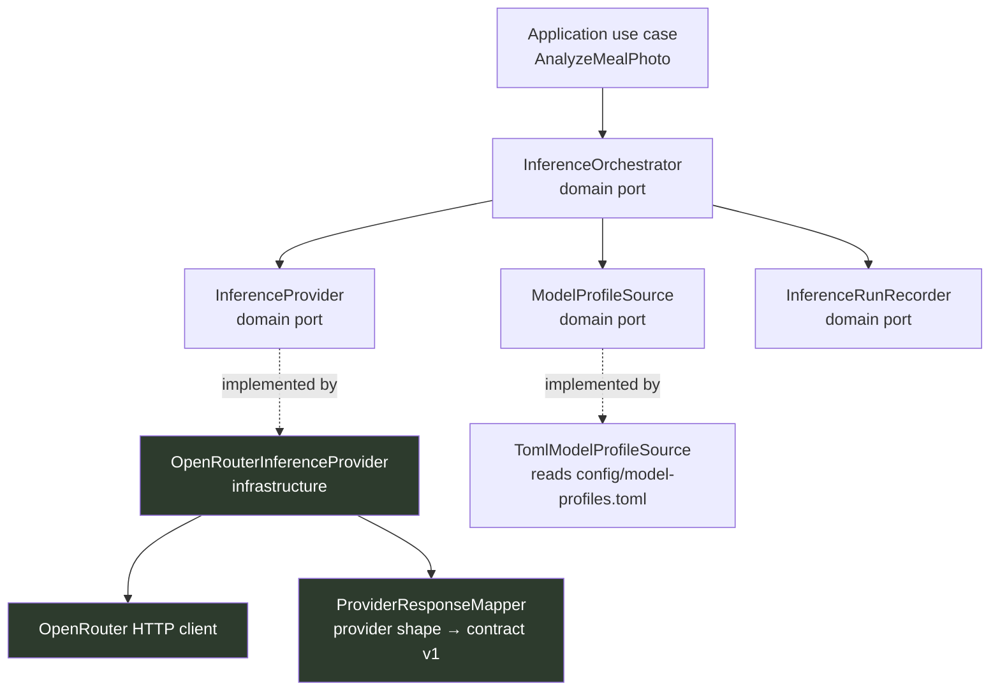

# 7. OpenRouter Integration Design

> **Design document. Describes the shape of the integration, not its current
> deployment state.**
>
> The layering, ports, model-profile configuration and two-pass orchestration
> below are implemented and wired in `apps/api/src/main.ts`. What this document
> does NOT establish, and must not be read as establishing: that a production
> market is enabled, that provider credentials exist in any environment, or that
> the per-request retention and erasure controls it would need are available —
> the OpenRouter request body has no such field, which is why
> `downstreamDeletionRequested` is constant `false` (handover-3 deferred item 2,
> G-4).
>
> **For current state, in this order:** `backend/AGENTS.md`, the open pull
> request, `.evidence/OWNER-DECISIONS.md`, and `git log`. Where this file and
> any of those disagree, they are right and this is stale.


## 7.1 The constraint

Principle 4 and AD-9: business logic must never depend on OpenRouter, OpenAI,
Gemini, or Claude. Model selection is configuration. Provider replacement is an
adapter swap.

That constraint is easy to state and easy to lose. It is lost the first time a
model ID appears in a service, a provider's error shape leaks into a domain
type, or a prompt is assembled somewhere that also knows about meals. The design
below is arranged so each of those is a build failure.

## 7.2 Layers



Shaded boxes are the only places that may know a provider exists. Everything
above the dotted lines is provider-agnostic.

## 7.3 Ports

```ts
// domain — no provider vocabulary anywhere in this file
interface InferenceProvider {
  readonly id: ProviderType;
  supports(profile: ModelProfile): boolean;
  infer(request: ProviderRequest): Promise<Result<ProviderResponse, InferenceFailure>>;
}

interface ProviderRequest {
  readonly attemptId: string;
  readonly modality: 'photo' | 'text';
  readonly payload: PayloadRef;          // opaque handle, not bytes
  readonly context: InferenceContext;    // catalogCountry, mealType, locale, goalSummary, priorMealSummary
  readonly profile: ModelProfile;
  readonly deadline: Deadline;
  readonly signal: AbortSignal;
}

interface ProviderResponse {
  readonly candidates: Candidate[];      // identity only — no nutrients
  readonly confidence: ConfidenceScore;
  readonly modelId: string;
  readonly durationMs: number;
  readonly usage: TokenUsage;
  readonly outcome: InferenceOutcome;
}
```

`InferenceFailure` is a closed typed union — `timeout`, `rate-limited`,
`provider-unavailable`, `content-rejected`, `malformed-response`,
`cancelled`, `budget-exceeded`. Provider error strings are mapped to these and
never propagated. A domain that can branch on an upstream message is coupled to
that upstream's release notes.

`PayloadRef` is an opaque handle to the in-flight buffer, not the bytes. The
orchestrator can route without ever holding image data, which keeps the disposal
guarantee in one place.

## 7.4 Model profiles are configuration

`config/model-profiles.toml` — the **only** file in the product containing a
model identifier.

```toml
schema = "supernutrition.backend.model-profiles.v1"
schema_version = 1
profile_version = "2026-07-29.1"

[routing]
confidence_threshold = 0.75      # below this, pass 2 is eligible
accept_band = "high"
max_passes = 2
pass_deadline_ms = 8000
total_deadline_ms = 20000

[[profile]]
id = "fast-identify"
pass = 1
provider = "openrouter"
model = "google/gemini-2.5-flash"
max_output_tokens = 1024
temperature = 0.0
cost_per_1k_input_micros = 75
cost_per_1k_output_micros = 300
enabled = true

[[profile]]
id = "fast-identify-fallback"
pass = 1
provider = "openrouter"
model = "openai/gpt-4o-mini"
enabled = true

[[profile]]
id = "deep-identify"
pass = 2
provider = "openrouter"
model = "openai/gpt-4o"
enabled = true

[[profile]]
id = "deep-identify-alt"
pass = 2
provider = "openrouter"
model = "anthropic/claude-sonnet"
enabled = false
```

Per AD-9, an active configuration is identified by immutable version, activation
time, and rollback target. `profile_version` is reported in provenance and
recorded in `inference_runs`, so any past result can be traced to the exact
roster that produced it.

A CI test greps the compiled output for known model-ID patterns outside this
file. Discipline is not a control.

## 7.5 The orchestrator

Responsibilities: provider selection, confidence routing, retry, deadlines,
telemetry, kill switch. Nothing else — it does not know what a meal is.

```
analyze(request):
  snapshot   = modelProfiles.current()            # one version for the whole attempt
  budget     = Deadline(snapshot.total_deadline_ms)

  pass1 = run(pass=1, snapshot, budget)
  if pass1 is failure and not retryable: return pass1
  if pass1.confidence >= snapshot.confidence_threshold: return accept(pass1)

  if snapshot.max_passes < 2 or budget.exhausted: return needsConfirmation(pass1)

  pass2 = run(pass=2, snapshot, budget, context = enrich(request.context))
  if pass2 is failure: return needsConfirmation(pass1)
  if pass2.confidence >= snapshot.confidence_threshold: return accept(pass2)
  return needsConfirmation(best(pass1, pass2))
```

### Confidence routing

| Condition | Outcome |
| --- | --- |
| `confidence >= threshold` | Accept; return candidates |
| `confidence < threshold`, pass 1, budget remains | Second pass with enriched context |
| `confidence < threshold` after final pass | Return candidates flagged `requiresConfirmation` |
| No candidate above the floor | `abstention` |

Three points that are easy to get wrong:

**Pass 2 is not a second transfer.** It reuses the payload already received for
the same `attemptId`. No new consent receipt is required, and none is requested,
because no new bytes leave the user's device. Treating pass 2 as a new transfer
would produce a consent prompt for something the user already consented to.

**`requiresConfirmation` is not a failure.** Low confidence returns candidates
plus a flag. The user is the authority (Principle 2), so the honest result of
uncertainty is a question, not an error.

**Thresholds are Gate G-5.** The `0.75` above is a placeholder for local
development. Until G-5 delivers a validated calibration, no public accuracy
claim is made and confidences are not compared across models — the spine's
convention table is explicit that cross-engine comparison needs a validated
transform.

### Retry

Retryable: `timeout`, `rate-limited`, `provider-unavailable`.
Not retryable: `content-rejected`, `malformed-response`, `cancelled`,
`budget-exceeded`.

Two attempts maximum per pass, exponential backoff with full jitter, always
inside the remaining deadline. On exhaustion the orchestrator tries the next
enabled profile for that pass; when profiles are exhausted it returns a typed
failure. A retry that outlives the client's own timeout is pure cost.

### Cancellation

Every provider call receives an `AbortSignal`. Client disconnect aborts it,
which aborts the upstream HTTP request. Cancellation is a first-class outcome,
recorded, and `CancellationException` equivalents are rethrown rather than
swallowed (spine convention table). A late provider response after cancellation
is discarded, never returned — AD-6 permits exactly one terminal outcome per
attempt.

## 7.6 Prompts

Prompt templates live in `infrastructure/openrouter/prompts/`, versioned by
`prompt_version`, and are recorded in provenance.

Rules:

- Prompts request **food identity only** — labels, ranks, confidence,
  assumptions. They never request calories, macros, or micronutrients. Nutrition
  comes from the catalog (AD-7), and asking a model for a number invites it to
  supply one.
- User-controlled text is never concatenated into instructions. The description
  from a voice entry is a delimited data field, and the system prompt states it
  is untrusted input to be classified, not instructions to follow.
- Responses are parsed against a strict schema. A response that does not match
  is `malformed-response`, not a best-effort salvage.
- Prompt text is never logged, never stored, and never written to
  `inference_runs` (AD-14).

Stage 1 defines these constraints. Stage 2's brief explicitly excludes prompt
implementation, so no template text is produced here.

## 7.7 Telemetry

Each pass writes one `inference_runs` row: `attempt_id`, `pass_number`,
`provider`, `model_id`, `model_profile_version`, `outcome`, `success`,
`confidence`, `duration_ms`, `duration_bucket`, token counts,
`estimated_cost_micros`, `failure_code`, `market_jurisdiction`,
`processing_region`, `environment`.

No user ID, no prompt, no response body, no candidate labels (§5.4).

This supports the stated goal — model benchmarking — directly: cost and latency
per model, outcome distribution per model, second-pass rate, and the marginal
value of pass 2 measured as the share of attempts it moves above threshold. That
last number is what decides whether the second pass earns its cost.

## 7.8 Cost controls

- Per-request ceiling from `max_output_tokens` and the pass budget.
- Per-principal daily spend cap in Redis; exceeding it returns
  `budget-exceeded` and disables remote for that principal until reset.
- Per-environment daily cap; exceeding it trips the kill switch and alerts.
- **Kill switch** (AD-24): a runtime flag disabling remote inference entirely.
  The gateway returns `503 PROVIDER_KILL_SWITCH`; the client falls back to its
  local engine and manual entry, both of which work without this service. The
  switch is operator-controlled, takes effect without a deploy, and its
  activation is drilled and recorded.

## 7.9 Adding a provider

The cost of this design is one indirection. The return is this list:

1. Implement `InferenceProvider` in a new `infrastructure/<provider>/` directory.
2. Implement its response mapper to contract v1.
3. Add profiles to `config/model-profiles.toml` with `provider = "<new>"`.
4. Bind the adapter in the composition root.
5. Run the shared provider contract suite against it.

No domain, application, or presentation file changes. If a provider swap ever
requires touching a use case, the abstraction has failed and the failure should
be treated as a defect rather than absorbed.
