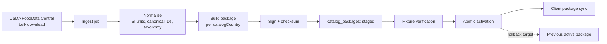

# 8. USDA Integration Design

> **Design document. Describes the shape of the integration, not its current
> deployment state.**
>
> The provider, its dataset-version provenance and the catalog search path are
> implemented and wired in `apps/api/src/main.ts`. What this document does NOT
> establish: that a USDA key is provisioned anywhere, or that any nutrition
> figure here has been reviewed for a market that has not been enabled.
>
> **For current state, in this order:** `backend/AGENTS.md`, the open pull
> request, `.evidence/OWNER-DECISIONS.md`, and `git log`. Where this file and
> any of those disagree, they are right and this is stale.


## 8.1 What this integration is for

Principle 5: AI identifies food, nutrition comes from catalog providers. MVP
source is USDA FoodData Central; Open Food Facts is a planned second source.

The important design question is not *how* to call USDA. It is *who owns the
number the user sees*. AD-7 and AD-19 answer that: the versioned on-device
catalog does, with deterministic serving calculation, and every displayed result
carries catalog source, dataset version, serving basis, and assumptions.

So this backend's relationship to USDA has three roles, in descending order of
importance:

1. **Package curation and publication** — building the signed, versioned catalog
   packages the client consumes. This is the primary role.
2. **Server-side catalog lookup** — returning catalog *facts* for text entry
   where no local package covers a term. Gated on G-2 and on a contract release.
3. **Reference data for server-originated meals** — the narrow case where a meal
   is created without a client-side grounding step.

What it is emphatically **not**: a live per-meal nutrition calculator that
overwrites what the device computed. That would create a second authority and
guarantee eventual disagreement.

## 8.2 Ports

```ts
interface NutritionProvider {
  readonly id: 'usda' | 'off';
  readonly datasetVersion: string;
  lookup(request: FoodLookupRequest): Promise<Result<FoodLookupResult, NutritionFailure>>;
  search(request: FoodSearchRequest): Promise<Result<CatalogMatch[], NutritionFailure>>;
}

interface FoodLookupRequest {
  readonly foodId: string;          // namespace-qualified: 'usda:fdc:171705'
  readonly catalogCountry: string;  // ISO 3166-1 alpha-2
}

interface FoodLookupResult {
  readonly foodRef: FoodReference;
  readonly factsPer100g: NutritionFact;   // always carries source + datasetVersion
  readonly servingOptions: ServingOption[];
  readonly catalogSource: 'usda' | 'off';
  readonly datasetVersion: string;
}
```

`USDAProvider` implements this. `OpenFoodFactsProvider` is the extension point
and requires no interface change — that is the test of whether the port was
drawn in the right place.

**Resolution order** when several providers are configured:
`CatalogCountry` preference → provider priority → first non-empty result. The
resolved source is always reported; a match never loses the identity of where it
came from.

## 8.3 Canonical identity

Food IDs are namespace-qualified: `usda:fdc:171705`, `off:3017620422003`.

Bare integers work until the second source arrives, at which point every stored
ID is ambiguous and there is no way to disambiguate retroactively. The namespace
costs a prefix now and prevents a data migration over user history later.

`serving_options` carry unit, amount, and gram weight, so a "medium banana" is
convertible to grams deterministically rather than by a per-caller guess.

## 8.4 Two calculators, one answer

The device computes nutrition for client-created meals; the backend may compute
it for server-originated lookups. Two implementations of one calculation is a
divergence risk, and the mitigation has to be structural:

- **Shared golden fixtures.** A fixture set covering every supported unit,
  numeric range, rounding boundary, and partial item is published as
  language-neutral data and consumed unchanged by both sides. Both must produce
  byte-identical results. This is the AD-19 requirement applied across the
  product boundary.
- **Where the fixtures live.** They belong under root `contracts/` as an
  immutable release, authored by the independent contract principal, because
  neither product may own a rule the other must obey (AD-36). No such release
  exists today. Document 11 schedules it; document 13 records the risk of
  proceeding without it.
- **`origin` on every snapshot.** `client-grounded` and `server-grounded` rows
  are distinguishable forever (§5.3), so a future divergence is measurable
  rather than invisible.
- **Precision discipline.** Source precision, calculation precision, and display
  rounding are three settings, not one. Decimal arithmetic throughout;
  `numeric(10,3)` in Postgres; rounding applied once, at display, on the client.

Until that contract release exists, **the server-side calculation path stays
disabled**. The lookup endpoint returns catalog facts and serving options; the
client calculates. This keeps one calculator in production while the second is
being made provably equivalent.

## 8.5 Package curation

The primary role. USDA FoodData Central is a bulk dataset, not a per-request
dependency.



Per AD-19, packages are signed, checksummed, license-identified,
schema-compatible, staged, atomically activated, rollback-capable, and
fixture-tested. Activation switches one row; a failed verification leaves the
previous package active and untouched.

`catalog_packages` and `catalog_items` (§5.3) hold the server-side mirror.
`GET /api/v1/catalog/packages?country=` gives the client what it needs to decide
whether to sync.

**Licensing.** USDA FoodData Central is US Government public domain; Open Food
Facts is ODbL, which carries share-alike obligations that affect redistribution.
`license_id` is a required column because these are not interchangeable, and the
obligation attaches per package. Confirming the terms for each source before
redistribution is a G-2 exit item, listed in document 11.

## 8.6 Live lookup and caching

For the gated server-side lookup path:

| Concern | Decision |
| --- | --- |
| Transport | HTTPS, `USDA_API_KEY` from the secret store, never in configuration files |
| Timeout | 3 s connect, 5 s total |
| Retry | 2 attempts, exponential backoff with jitter, on 5xx and timeouts only |
| Circuit breaker | Opens after 5 consecutive failures; half-open probe after 30 s |
| Rate limit | Client-side token bucket below the published quota |
| Cache | Redis, keyed `catalog:{source}:{datasetVersion}:{foodId}`, TTL 7 days |
| Search cache | Keyed `catalog:search:{source}:{datasetVersion}:{country}:{normalizedTerm}`, TTL 24 h |
| Cache invalidation | Dataset version is in the key, so a package upgrade invalidates by construction |
| Degraded mode | Breaker open → typed `provider-unavailable`; the client's local package continues to work |

Putting `datasetVersion` in the cache key removes a whole class of bug: there is
no stale-after-upgrade state to invalidate, because the old key is simply never
read again.

## 8.7 Data quality

USDA data is uneven, and pretending otherwise produces confident wrong numbers:

- **Missing nutrients.** Absent is not zero. A missing fiber value serializes as
  `null` and is displayed as unknown. Summing `null` as `0` understates totals
  and is prohibited; aggregate totals carry a `partial: true` flag when any
  component is unknown.
- **Multiple records for one food.** Foundation, SR Legacy, and Branded entries
  overlap. Curation applies a documented precedence and records which record was
  chosen, so a match is explainable.
- **Serving ambiguity.** "1 cup" without a gram weight is not usable. Items
  lacking a gram weight for an offered serving option do not offer that option.
- **Branded coverage.** Non-US branded coverage is weak, which is precisely why
  `CatalogCountry` is a first-class axis and why Open Food Facts is planned.

## 8.8 Extension to Open Food Facts

Post-MVP, and the design is ready for it:

1. Implement `OpenFoodFactsProvider` against the same `NutritionProvider` port.
2. Add `off:` to the canonical ID namespace (already supported).
3. Register the provider with a per-country priority.
4. Extend package curation to build multi-source packages.
5. Track ODbL attribution and share-alike obligations per package.

No change to `NutritionProvider`, to any domain type, or to the snapshot shape.
If step 1 turns out to require a port change, that is the signal the port was
modelled around USDA's response rather than around the concept of a catalog.
