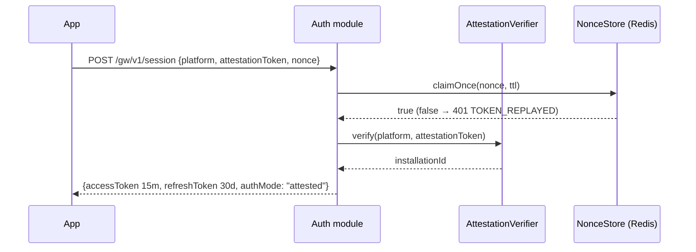

# 9. Security Design

## 9.1 Threat model in one page

| Asset | Threat | Control |
| --- | --- | --- |
| User photos in flight | Retention, logging, leak to provider without consent | AD-8 disposal contract (§9.6), consent binding (§9.5), gateway has no repository dependency |
| Provider credentials | Extraction from a mobile client | Credentials exist only server-side (AD-13); mobile never holds one |
| Gateway endpoint | Unauthenticated abuse, cost amplification | Attested session tokens, replay detection, layered rate limits (§9.3–9.4) |
| User meal history | Cross-tenant read | Ownership check on every query; 404 not 403 for foreign resources |
| Refresh tokens | Theft and reuse | Hashed at rest, rotation with family revocation on reuse (§9.2) |
| Telemetry | Sensitive data leaking through diagnostics | AD-14 allowlist enforced by a serializer, not by review (§9.8) |
| Market policy | Serving a market its law forbids | Fail-closed resolution, expiry, per-modality (§9.5) |
| Production environment | `TEST_MODE` reaching it | Boot assertion, not a warning (§9.2) |

## 9.2 Authentication

### Production flow (AD-21)

Access tokens are short-lived JWTs (15 minutes) signed with RS256, carrying
`sub`, `installationId`, `environment`, `scope`, `authMode`, `jti`, `iat`, `exp`.
`environment` is a claim, so a staging token presented to production fails on
claim mismatch rather than on signature luck.

Refresh tokens are opaque 256-bit random values, stored **hashed** (SHA-256),
valid 30 days, rotated on every use. Presenting an already-rotated token revokes
the entire `refresh_family_id` — the standard detection for a stolen token, and
the reason lineage is stored at all.

Signing keys rotate on a schedule with an overlap window; JWKS is served with a
`kid` so verification survives rotation. Revocation is checked against the
`sessions` table and a Redis denylist keyed by `jti`.

### `TEST_MODE` — fenced, not a mode

The stage brief requires sessions handed out without verification because the
client has no auth integration yet. That is a legitimate development need and a
production catastrophe, so the fence is structural:

Test mode skips **attestation**, not **authentication**. Both surfaces still
require a bearer credential: the contract marks `Authorization` non-optional,
`authentication-failed` covers a missing token as much as an untrusted one, and
the rate limiter keys on `installationId` — so an uncredentialed request would
both spend money at a provider and share one throttling bucket with every other
anonymous caller. A credential too short to be one is refused rather than folded
into a shared fallback principal, because a caller who can pick the principal
can pick whose budget to spend.

1. **Boot assertion.** With `TEST_MODE=true` and `NODE_ENV=production`, or a
   resolved gateway environment of `production`, the process **exits non-zero at
   startup**. It does not warn and continue. A warning in a log is a control
   nobody reads at 3am.
2. **Token labelling.** Test-mode tokens carry `authMode: "test-mode"`. Every
   consumer, log line, and telemetry row sees it.
3. **Transfer prohibition.** The gateway's remote-transfer path rejects
   test-mode tokens with `403 TEST_MODE_FORBIDDEN` unless the resolved market is
   a designated non-production fixture market. Test mode can never cause a real
   user photo to reach a real provider.
4. **Visibility.** A persistent startup banner; `/health/ready` reports
   `authMode`; the value is a dimension on every dashboard.
5. **Fixture adapter binding.** `AttestationVerifier` has a fixture
   implementation, and the composition root binds it **only** after the boot
   assertion passes.

The net effect: with `TEST_MODE` on, everything is testable except the one thing
that must never be faked.

### Authorization

Scope claims are `product`, `gateway`, or `both`. Beyond scope, authorization is
resource ownership: every query filters by `userId` from `AuthContext`, and a
repository method that can return another user's row does not exist. Ownership
is applied in the repository, not the controller, because a controller check is
one forgotten route away from a leak.

## 9.3 Rate limiting

Layered, because one limiter cannot serve both a cheap read and a paid inference
call:

| Layer | Key | Limit | Purpose |
| --- | --- | --- | --- |
| Global per IP | IP | 300 / min | Crude flood protection |
| Per principal, product | `userId` | 120 / min | Normal API use |
| Per principal, gateway | `installationId` | 20 / hour | Cost control on paid calls |
| Per principal, daily spend | `installationId` | Configured micros | Hard cost ceiling |
| Per environment | environment | Configured micros | Kill-switch trigger |
| Auth endpoints | IP + installation | 10 / min | Credential stuffing |

Sliding-window counters in Redis. Responses carry `X-RateLimit-*`; 429 carries
`Retry-After`. The rate-limit principal is `installationId`, not a raw IP or a
user ID where avoidable — AD-14 asks for a privacy-preserving principal, and
carrier NAT makes IP both over- and under-inclusive.

Redis unavailability **fails closed** on the gateway (paid, abusable) and
**fails open** on product reads (unpaid, and a cache outage should not stop a
user seeing yesterday's lunch). That asymmetry is deliberate and worth stating,
because a single global policy gets one of the two cases wrong.

## 9.4 Upload limits

Enforced in this order, cheapest first:

1. `Content-Length` over limit → `413` before reading a byte.
2. `Content-Type` not in the allowlist (`image/jpeg`, `image/png`, `image/webp`)
   → `415`.
3. Streamed size guard → abort mid-stream if the declared length lied.
4. Magic-byte sniff → the declared type must match actual content.
5. Dimension and decode bounds → reject decompression bombs.

Limits: 8 MB per payload, 4096×4096 pixels, one payload per request. Values are
configuration, not literals.

The gateway does not re-encode or transform images. The client has already
stripped EXIF and GPS and normalized the payload (AD-8), and the digest in the
consent receipt binds *that* payload. Re-encoding server-side would break the
binding and would mean the bytes analysed are not the bytes consented to.

## 9.5 Consent and market policy

A remote transfer requires **all** of the following. Any one absent fails closed:

1. A consent receipt whose `digest` matches the SHA-256 of the received
   payload. Mismatch → `400 MALFORMED_CONSENT`. This is the AD-8 binding, and
   checking it server-side is what makes it more than a client-side promise.
2. `modality` matching the endpoint, with the reviewed consent copy version for
   *that* modality. Photo and text are decided independently; presenting one
   modality's copy for the other fails closed (MP-4).
3. A resolved market posture of `unrestricted` or `restricted-in-region`, with
   `remoteInference.<modality> = true`.
4. `expiresAt` in the future. An expired posture behaves as `unresolved` **at
   resolution time**, not at build time (MP-3).
5. A `processingRegion` present in `permittedProcessingRegions`.
6. Retention version and configuration version present and supported.

Absent, `unresolved`, `prohibited`, or expired → `403 MARKET_NOT_PERMITTED`, and
**zero provider calls are made**. Nothing infers a posture from a neighbouring
market, shared language, currency, or region grouping (MP-1).

`GET /gw/v1/policy/market` exists so the client can display the resolved
jurisdiction and processing region **before** the consent sheet renders (MP-7).
Users consent to the resulting transfer; they never pick provider routing.

Receipts are persisted in `consent_receipts` (§5.3) as the durable proof the
precondition was met. The payload is not.

## 9.6 Photo disposal

The AD-8 deletion contract covers device, gateway, provider, temporary files,
caches, queues, logs, backups, and failure paths.

Server side:

| Surface | Guarantee |
| --- | --- |
| Memory | Buffer released on every terminal path via `finally`; success, error, timeout, and cancellation are the same code path |
| Disk | No spooling to disk. Body parser configured for memory-only with the size cap; no `tmp` fallback |
| Database | No table has a column that can hold image bytes. Structurally impossible, not merely unused |
| Logs | Request/response bodies are never logged; the multipart field is excluded at the serializer |
| Cache | Payloads are never cached. Redis holds counters, nonces, and idempotency records only |
| Queues | No queue carries payloads |
| Backups | Nothing durable exists to back up |
| Provider | Zero-retention terms required at G-4. `DELETE /gw/v1/inference/{attemptId}` suppresses the result and does NOT issue a downstream deletion request: no provider adapter exposes an erasure operation, so there is nothing to ask. The capability is itself a G-4 provider/DPA decision (owner decision D-01) |

The gateway route group has **no dependency on `packages/database`** (§3.2,
§4.9). Its inability to persist a photo is a dependency-graph property that a
lint rule enforces, rather than a behaviour that a reviewer must notice.

Honest limits, stated because AD-8 requires honesty rather than reassurance:
once bytes have been transferred to a provider, a deletion *request* is what can
be made. The API reports `recallClaimed: false`, and no user-facing copy should
say otherwise.

**Evidence:** a conformance test asserts zero bytes written to disk, zero rows
containing payload data, and zero log lines containing payload content, across
success, error, timeout, and cancellation. This is part of the AD-31 non-waivable
suite: no suppression or fixture update may remove it.

## 9.7 PII protection

| Category | Handling |
| --- | --- |
| Photos | Never durable (§9.6) |
| Voice transcripts | Stored on the meal event; never logged, never in telemetry |
| Free-form food labels | Stored on the meal event; never in telemetry (AD-14 forbids free-form labels) |
| Email / identifiers | Encrypted at rest via database-level encryption; not in logs |
| Health-adjacent data | Nutrition targets and meal history are sensitive in several jurisdictions; access-controlled and included in export and erasure |
| Erasure | `DELETE /api/v1/users/me` fans out over every `ErasurePort` and produces an auditable `ErasureReport` (§4.2) |
| Export | `POST /api/v1/users/me/export` produces a machine-readable archive |

Medical and allergen conclusions are prohibited (AD-40). This binds the coach
message catalog and any inference output surfaced as advice, and is tested by
scanning the message catalog for prohibited claim patterns.

## 9.8 Secrets management

- Secrets come from the platform secret manager, injected as environment
  variables at runtime. Never in the repository, never in an image layer, never
  in `.env` outside local development.
- `.env.example` contains keys with empty or obviously fake values only.
- **OpenRouter key isolation:** the key is read once at startup into the
  OpenRouter adapter's closure. It is not on a config object other modules can
  reach, not in a global, and not re-readable. Only
  `infrastructure/openrouter/` can name it.
- Distinct keys per environment. A staging key that works in production is a
  blast-radius decision made by accident.
- Rotation is a documented runbook with an overlap window; the compromise
  runbook required by AD-21 covers revocation, rotation, and forced re-attestation.
- Secret scanning runs in CI over the diff; a match fails the build.
- Startup validates that every required secret is present and non-placeholder.
  Failing at boot beats failing at the first user request.

## 9.9 Transport and headers

TLS 1.3 minimum, HSTS with preload. The client pins the gateway origin and trust
key set through its signed build flavor (AD-21), so a compromised DNS answer does
not silently redirect traffic.

`Content-Security-Policy: default-src 'none'` (this is a JSON API),
`X-Content-Type-Options: nosniff`, `Referrer-Policy: no-referrer`,
`Cache-Control: no-store` on every authenticated response. CORS is disabled by
default — the consumer is a native client, and an allowlist is added only if a
first-party web client is ever introduced as its own product root.

## 9.10 Logging and telemetry

Structured Pino. The logger's serializer is **built from
`config/telemetry-allowlist.toml`**, and any field not on the allowlist is
dropped before the record is emitted (AD-14). An allowlist implemented as a
review convention is not an allowlist.

Permitted: correlation ID, opaque attempt ID, route, capability tier, duration
and resource buckets, terminal outcome, controlled action codes, model, catalog,
and configuration version IDs, environment, `authMode`.

Forbidden, and dropped by construction: image bytes, image digests joinable to a
user, filenames, paths, free-form labels, voice transcripts, prompts, provider
request or response bodies, headers, tokens, and user IDs in `inference_runs`
(§5.4).

Server-side correction telemetry stays **off** until G-6 closes.

**Test:** a negative test feeds a record containing every forbidden field and
asserts the emitted line contains none of them. This is part of the AD-31 suite.

## 9.11 Production enablement checklist (AD-24)

Production remote inference does not turn on until all of these exist. This is a
gate, not a wish list:

- [ ] Named service owner and on-call rotation
- [ ] SLOs with alerts: availability, gateway p99 latency, provider error rate, cost per day
- [ ] Retention and deletion evidence across provider, caches, queues, logs, backups, failure paths
- [ ] User-rights path proven end to end: export and erasure
- [ ] Jurisdiction-specific data-flow inventory
- [ ] Cost and rate-limit dashboards
- [ ] Incident and breach-notification runbook
- [ ] Provider kill switch, operator-controlled, effective without deploy
- [ ] Configuration rollback path
- [ ] **Recorded rollback drill** — performed, not planned
- [ ] G-4 signed: provider, region, DPA, retention and training terms, cost, abuse policy
- [ ] Privacy/legal approval for provider region and telemetry purpose
- [ ] `TEST_MODE` proven impossible in production (boot assertion test in CI)
