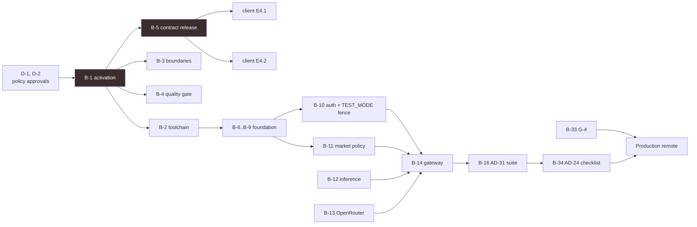

# 11. Technical Backlog

Sequenced work implied by this architecture. Items marked **⚠ approval** need a
decision from a principal other than the backend owner before they can proceed.

## 11.0 Debt created by Stage 1 itself

Two protected files were modified to let this documentation exist, and both need
review by their owning principals. Recording them here rather than leaving them
to be discovered.

| ID | Item | Owner | Priority |
| --- | --- | --- | --- |
| **D-1** ⚠ | `backend/mobile-api/quality-check` was extended to allowlist `docs/**.md`. The AD-37 gate previously rejected *every* file in the product root except the lifecycle record and itself, which is stricter than AD-37's actual rule (no production source, dependency/lock state, runtime, deployable build, deploy config, or undeclared executable). The allowance is narrowed to inert Markdown and is separately asserted to contain nothing executable. | Backend | P0 |
| **D-2** ⚠ | `scripts/verify-root-boundaries.sh` cross-product edge scan now excludes `**/docs/**/*.md`. The scan is a text match for `mobile[/. ]` and `web/landing`, which cannot distinguish a build or runtime edge from prose, and architecture documentation must be able to name the boundary it documents. Every other path in each product root, including all checked-in configuration and manifests, remains covered. Negative fixtures re-run clean. | Repository policy | P0 |

Both changes are narrow and commented in place. If either owner prefers a
different resolution — a separate docs root outside the product tree, or a
policy-level exemption list — reverting is a one-line change in each file.

## 11.0b Debt created by Stage 2 activation

Three further root-policy files changed so the AD-37 backend activation could
happen at all. Each was a checked-in assumption that backend would stay
`preselection` forever, which AD-37 explicitly contradicts. All three changes
make the checks **stricter**, not looser, and each was verified against
deliberate violations before being accepted.

| ID | Item | Owner | Priority |
| --- | --- | --- | --- |
| **D-3** ⚠ | `scripts/verify-root-boundaries.sh` cross-product scan now matches **path-shaped** references (a relative traversal into a sibling root, or a quoted path beginning at one) rather than any textual occurrence of a sibling root's name. The old scan flagged the product description, a source comment, and — decisively — the ESLint rule that enforces AD-36, which cannot express the forbidden pattern without containing it. Verified: five real edge shapes (relative import, `file:` dependency, workspace glob, build path, re-export) are all still rejected. | Repository policy | P0 |
| **D-4** ⚠ | `scripts/verify-product-identity.sh` asserted that `backend/mobile-api` and `web/landing` must *remain* `preselection`. AD-37 permits an atomic transition to `active` in a reviewed toolchain story, so that assertion made the transition impossible. It now validates whichever state is declared: `preselection` must claim no quality, no production source, and no runtime; `active` must claim quality **and** carry every activation artifact plus a nonempty inventory agreeing with the lifecycle record. Verified: a fake activation missing the inventory, the quality claim, or with an unknown state is rejected. | Repository policy | P0 |
| **D-5** | `scripts/product-identity-negative-fixtures.sh` now copies `product-inventory.toml` alongside `product-lifecycle.toml`, because an active lifecycle record is only valid with its inventory and the baseline fixture must be the real repository state. | Repository policy | P1 |

The root-boundaries status line also now reports each product's actual
lifecycle rather than the hardcoded string `web/backend preselection`.

## 11.0c Debt created by the Stage 3 contract release

| ID | Item | Owner | Priority |
| --- | --- | --- | --- |
| **D-6** ⚠ | `scripts/verify-mobile-api-contract.sh` computed the release digest over a **hardcoded three-file list**, while `RELEASE.md` describes it as covering "the sorted release files". Once the release grew past the stub, the hardcoded set would have silently stopped covering the 14 new files — a released contract whose digest ignores most of its own content. The digest is now derived from the filesystem and cross-checked against the manifest in `schema.toml`. The validator also gained the Stage 3 verification checks (typed and documented fields, unique `gatewayCode`, no nutrition keys, §9.5 receipt coverage, fail-closed postures, `recallClaimed` constrained, fixture/taxonomy agreement). Verified against 11 deliberate violations. | Repository policy | P0 |
| **B-5** ✅ | **Contract release: gateway envelope.** Delivered by Stage 3 — request/response envelopes, 21-code error taxonomy, consent receipt, rate-limit shape, transfer states, market policy, and 8 canonical fixtures. This was the critical path item blocking client stories E4.1 and E4.2; both are now unblocked. Still requires contract-owner approval before it counts as published (AD-36). | Contract principal | Done, pending approval |

## 11.1 P0 — before any production source

| ID | Item | Notes |
| --- | --- | --- |
| **B-1** ⚠ | **AD-37 activation story.** Pinned runtime/build/lint/test/coverage tuple; product-local frozen dependencies and lock; schema-conforming nonempty `product-inventory.toml`; real read-only `quality-check`; nonzero tests and coverage denominators; artifact; owners; deploy/rollback skeleton. Atomic — all of it, or none. | Blocks everything. Stage 2's skeleton **cannot** flip the lifecycle by itself: interfaces with no tests satisfy none of the evidence requirements. |
| **B-2** | Pin the toolchain tuple: Node LTS, TypeScript, Drizzle, drizzle-kit, Zod, Pino, Vitest, coverage tool, ESLint + boundaries plugin, formatter. One central manifest, frozen install, product-local cache. | AD-26. Versions selected in the B-1 story, not invented here. |
| **B-3** | Dependency-rule enforcement (§4.9): boundaries zones, restricted imports, gateway-cannot-persist rule, domain-purity rule, product-boundary rule. | Every invariant in documents 2 and 4 is worth its enforcement and no more. |
| **B-4** | `quality-check` active-state implementation: compile, lint, unit test, 85% line and branch per module and per deduplicated aggregate, 100% changed lines and branches, dependency integrity, schema-versioned evidence, validation of every supported `contracts/mobile-api` release. Read-only. | AD-27, AD-33. |
| **B-5** ⚠ | **Contract release: gateway envelope.** Request/response shapes, error taxonomy, consent receipt schema, canonical fixtures for upload, cancellation, timeout, redaction, version mismatch, rate limiting, malformed response, at-most-once effects. | Contract principal authors and publishes. **Blocks client E4.1 and E4.2** — highest leverage item in the plan. |

## 11.2 P1 — E4 delivery

| ID | Item | Notes |
| --- | --- | --- |
| **B-6** | Shared kernel: `Result<T,E>`, error hierarchy and HTTP mapping, event bus, value objects, constants. | |
| **B-7** | Typed configuration module with Zod-validated env schema and startup validation of every required secret. | Fail at boot, not at first request. |
| **B-8** | Pino logging with an allowlist-driven serializer built from `config/telemetry-allowlist.toml`, plus correlation-ID middleware. | AD-14. Allowlist as code, not convention. |
| **B-9** | Database package: 19 schema files, initial migration, seeds (five achievements, fixture markets), repository adapters, `withTransaction`. | Document 5. |
| **B-10** | Auth module with the `TEST_MODE` boot assertion and a CI test proving the process refuses to start in production. | §9.2. |
| **B-11** | `MarketPolicyResolver` plus `GET /gw/v1/policy/market`, fail-closed with expiry evaluated at resolution time. | AD-41, MP-1..MP-8. |
| **B-12** | Inference module: ports, orchestrator, two-pass confidence routing, retry, deadlines, cancellation. | Document 7. |
| **B-13** | OpenRouter adapter, response mapper, `config/model-profiles.toml`, plus the CI grep asserting no model ID exists outside that file. | |
| **B-14** | Gateway route group in the order of §10.4, with no `packages/database` dependency. | E4.3. |
| **B-15** | `inference_runs` recorder with no user foreign key, plus the retention job (90 days, then rollups). | §5.4. |
| **B-16** | **AD-31 non-waivable conformance suite**: disposal on all four terminal paths, consent binding, replay, forbidden-log capture, three transfer states, duplicate effects, market fail-closed, modality separation, expiry. | No suppression or fixture update may remove a scenario. |
| **B-17** | Idempotency middleware: key + request digest in Redis, 24 h, `409` on digest mismatch. | §6.7. |
| **B-18** | OpenAPI 3.1 generated from Zod schemas, with a CI diff check against the committed document. | §6.9. |

## 11.3 P2 — product API (post-E4)

| ID | Item | Notes |
| --- | --- | --- |
| **B-19** ⚠ | Contract release for Surface B before any client consumes it. | Same independent-principal rule as B-5. |
| **B-20** | Meals module: aggregate, factory for three sources, revision/supersede, cursor pagination. | Core domain. |
| **B-21** | Domain event bus with after-commit dispatch and idempotent handlers keyed by event ID. | §2.5. |
| **B-22** | Gamification: data-driven rule engine, XP ledger, streaks from distinct local dates, unique constraints for replay safety. | No achievement key in a conditional. |
| **B-23** | Progress projector with `rebuild(userId, from, to)` and a maintenance command. | A projection that cannot be rebuilt is a source of truth. |
| **B-24** | Goals with versioned validity periods and a daterange exclusion constraint. | §4.3. |
| **B-25** | Coach with a reviewed message catalog, `message_key` + params storage, and a lint test for prohibited medical/allergen claims. | AD-40. |
| **B-26** | Users: profile, consent history, export, erasure fan-out over `ErasurePort` with an auditable report. | AD-24 user rights. |
| **B-27** | Journey feed with a stable total order across heterogeneous item types. | §6.6. |

## 11.4 P2 — catalog and nutrition

| ID | Item | Notes |
| --- | --- | --- |
| **B-28** ⚠ | **G-2 exit**: source, version, license, canonical ID and unit-conversion policy, country coverage, missing-record policy, signed package, provenance fixtures. Includes confirming USDA public-domain terms and Open Food Facts ODbL share-alike obligations for redistribution. | Blocks grounding beyond fake catalogs. |
| **B-29** ⚠ | **Shared nutrition-calculation contract release**: golden fixtures for every supported unit, range, rounding boundary, and partial item, consumed unchanged by client and backend. | Until this exists, the server-side calculation path stays disabled (§8.4). |
| **B-30** | USDA package curation pipeline: ingest, normalize, build, sign, stage, verify, atomically activate, rollback. | AD-19. |
| **B-31** | Catalog module: search with GIN index, canonical namespaced IDs, dataset-versioned cache keys. | §8.6. |
| **B-32** | `partial: true` propagation for unknown nutrients; absent is never summed as zero. | §8.7. |

## 11.5 P2 — operations

| ID | Item | Notes |
| --- | --- | --- |
| **B-33** ⚠ | **G-4 exit**: provider, runtime, API, region, cost, abuse decision; DPA and retention/training terms; staging threat model; operations plan. | Blocks production remote release. |
| **B-34** | AD-24 checklist (§9.11) including the **recorded rollback drill**. | Performed, not planned. |
| **B-35** | Provider kill switch, operator-controlled, effective without deploy, with an activation drill. | |
| **B-36** | SLOs, alerts, cost and rate-limit dashboards, jurisdiction data-flow inventory. | |
| **B-37** | Incident and breach-notification runbook; AD-21 key-compromise runbook. | |
| **B-38** | Secret rotation runbook with overlap window; CI secret scanning over the diff. | |
| **B-39** | Migration rehearsal against a restored production-shaped dataset in staging, with timings recorded. | §5.6. |

## 11.6 P3 — deferred, with triggers

Each item has a condition that promotes it. Items without a trigger are not
scheduled work; they are speculation.

| ID | Item | Promote when |
| --- | --- | --- |
| **B-40** | Extract Surface A into its own deployable | Gateway p99 couples to product load, provider spend needs independent scaling, or a residency posture requires gateway/database regional separation |
| **B-41** | Move the event bus onto a durable queue | Post-commit handler failure rate is user-visible, or handler latency affects the meal-creation response |
| **B-42** | Read replica for progress and journey queries | Read load measurably affects write latency |
| **B-43** | Materialize XP balance | `SUM(xp_transactions)` appears in slow-query logs |
| **B-44** | Partition `meal_events` by month | Table exceeds a size where index maintenance becomes the constraint |
| **B-45** | Open Food Facts provider | A target market's USDA branded coverage proves inadequate |
| **B-46** | Server-side correction telemetry | G-6 closes |
| **B-47** | Per-user cost attribution | A commercial need exists **and** a G-6-style consent/retention design is approved. Not a column added to `inference_runs` |
| **B-48** | Confidence-based hybrid routing tuning | G-5 supplies validated calibration |

## 11.7 Dependency summary

Two items gate everything else: **B-1** because no source may exist before it,
and **B-5** because two client stories are blocked on it and it is cheap. Neither
is a large piece of work; both are easy to schedule late by accident.
